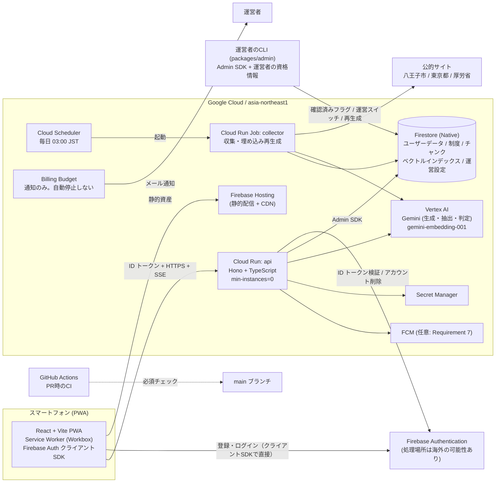
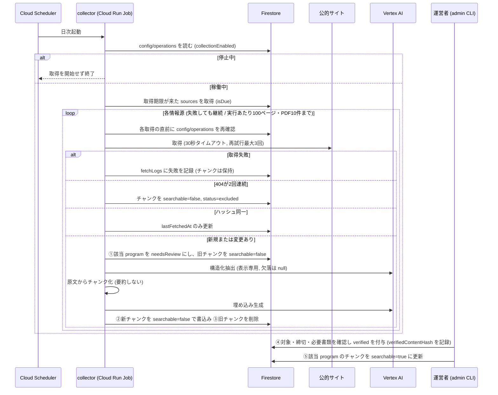
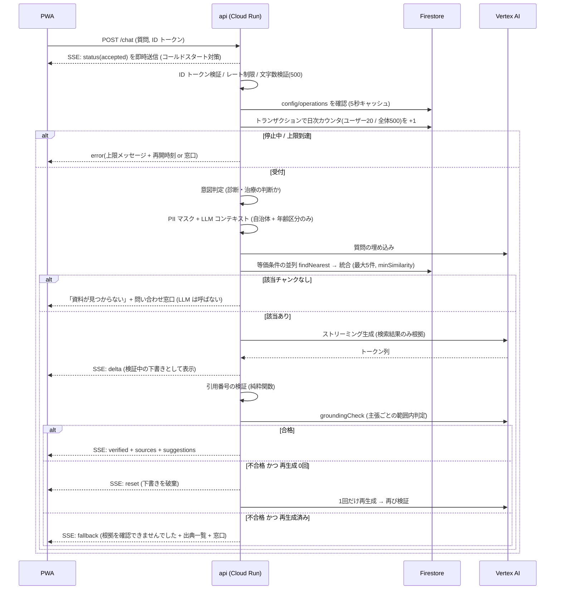
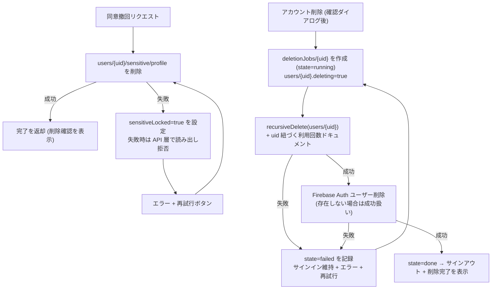
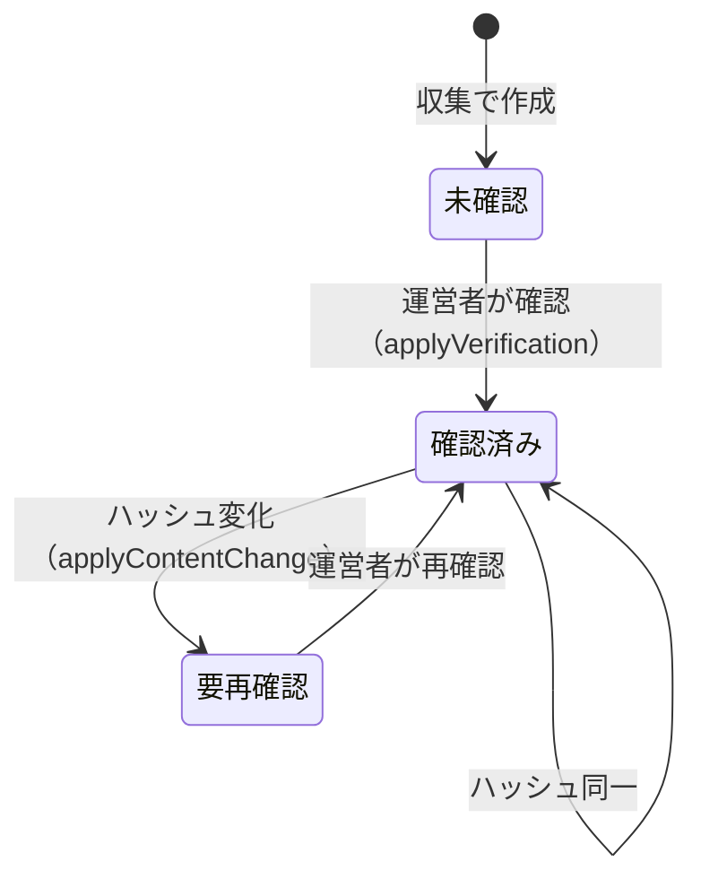

# 設計書: hachioji-gov（子育て世帯向け 医療・福祉情報ナビ）

## Overview

hachioji-gov は、八王子市の子育て世帯（妊娠中の人を含む）向けに、国・東京都・八王子市の公的情報を集約し、運営者が確認した制度だけを世帯に合わせて提示し、出典つきでAIに相談できるスマートフォン向け PWA である。本設計書は `requirements.md`（Requirement 1〜15）を実現する技術設計を定義する。

本設計には、設計時点で公式ドキュメントから確認できなかった前提がある。それらは末尾の「未確認事項とトレードオフ」にまとめた。実装前に必ず読むこと。

### 設計の基本方針

| 方針 | 内容 | 関連要件 |
| --- | --- | --- |
| Google Cloud 一本化 | ユーザーデータは東京リージョン（asia-northeast1）に保存する。ただし認証情報の処理は海外の可能性がある（後述） | Requirement 9.8, 9.12, 13.6 |
| TypeScript 統一 | フロント・API・収集・評価すべて TypeScript（Node.js 22） | 技術的制約 |
| サーバーレス | Cloud Run（min-instances=0）、Cloud Run Jobs、Firestore、Firebase Hosting のみ。常時稼働サーバーは使わない | Requirement 13.1 |
| ベクトルDBは Firestore | 別サービスを増やさず、等価条件のみの事前フィルタつき KNN を Firestore で行う | Requirement 3, 5 |
| 根拠は原文抜粋のみ | チャンクは原文抜粋・出典URL・見出し／PDFページ・取得版ハッシュで構成し、AI要約を含めない。構造化情報は表示専用 | Requirement 3.9, 3.10 |
| 確認済みの制度だけを使う | `verified` かつ `needsReview` でない制度のみを表示・検索の対象にする | Requirement 3.13〜3.16 |
| 認証は Firebase 標準 | 独自ログインAPI・ロックアウトは実装しない。APIには別途レート制限を置く | Requirement 1.8〜1.10 |
| 画像は扱わない | 画像の受付・保存・読み取りは MVP の対象外（将来対応） | Requirement 5.5, 6.7, 9.5 |
| 設定の外出し | AIモデル名・リージョン・各種上限は `config/app.config.json` に置く | Requirement 13.6, 13.7 |
| 上限は設計目標 | 20ドルは保証ではなく設計目標。日次上限と運営スイッチで被害を抑える | Requirement 13 |

### 調査結果の要約（設計に反映した事項）

調査日は設計時点。各項目は公式ドキュメントで確認した内容と、確認できなかった内容を分けて書く。

| 項目 | 確認できた内容 | 設計への反映 | 出典 |
| --- | --- | --- | --- |
| Firestore ベクトル検索の事前フィルタ | `and` と `or` の複合フィルタが使え、複合ベクトルインデックスが必要。公式の例は等価条件（`==`）のみ。`array-contains` や `in` との併用可否は、確認したページには記載がない | フィルタを等価条件のみに正規化する設計にした（「検索設計」参照）。`array-contains-any` / `in` は使わない | [Firestore ベクトル検索](https://firebase.google.com/docs/firestore/vector-search) |
| ベクトルの制約 | 次元は最大 2048、インデックス種別は `flat` のみ。Standard エディションでは1回の返却上限が 1000 件。リアルタイムリスナー非対応。Node.js クライアントは対応 | 次元 768、`flat`、返却は 5 件 | 同上 |
| 距離指標 | 正規化済みベクトルでは `DOT_PRODUCT` が `COSINE` と同じ並びで、公式は `DOT_PRODUCT` を推奨。距離しきい値は `COSINE`/`EUCLIDEAN` では以下、`DOT_PRODUCT` では以上 | L2 正規化して `DOT_PRODUCT` を使う。しきい値は `minSimilarity`（以上）として設定 | 同上 |
| インデックス定義 | `firestore.indexes.json` に `vectorConfig: { dimension, flat: {} }` で定義でき、等価条件用の `order` フィールドと同じインデックスに並べられる | 生成スクリプトで `firestore.indexes.json` を作り `firebase deploy --only firestore:indexes` で作成する | [インデックス設定の仕様](https://firebase.google.com/docs/reference/firestore/indexes/) |
| 埋め込みモデル | `gemini-embedding-001` は既定 3072 次元で、出力次元を指定して縮小できる。推奨は 3072 / 1536 / 768 | 768 次元（設定値）。縮小後は保存前に L2 正規化する | [Get text embeddings](https://cloud.google.com/vertex-ai/generative-ai/docs/embeddings/get-text-embeddings)、[Gemini Embedding GA](https://developers.googleblog.com/es/gemini-embedding-available-gemini-api/) |
| Vertex AI のデータ保持 | 顧客データで学習しない。不正利用監視のためのプロンプトログがある場合があり、ゼロデータ保持には例外申請が必要と記載されている。暗黙のキャッシュ（メモリ内・永続）は既定で有効で、24時間以内に削除される。リクエスト・レスポンスのログは既定で無効。リージョン指定のエンドポイントでは永続キャッシュが指定ロケーション内に留まる一方、グローバルエンドポイントでは任意のリージョンで処理されうる | 設計では「ゼロデータ保持は前提にしない」。プライバシーポリシーには「保持の可能性がある」と書く。リージョン指定のエンドポイントを使う。キャッシュ無効化は任意の対策として手順書に記載する | [Vertex AI とゼロデータ保持](https://docs.cloud.google.com/vertex-ai/generative-ai/docs/vertex-ai-zero-data-retention) |
| Firebase Authentication の場所 | Firebase の場所一覧に Authentication の場所指定は載っていない。海外で処理される可能性がある | 認証情報（メール、認証ID）は海外処理の可能性があることをプライバシーポリシーに明示する。断定はしない | [Firebase の場所](https://firebase.google.com/docs/projects/locations) |

> 注: 料金・提供状況・保持条件は変わりうる。実装前に最新の公式ドキュメントで再確認すること。確認できなかった点は「未確認事項とトレードオフ」に列挙している。

## Architecture

### システム構成図



### 構成要素の選定理由

| 要素 | 選定 | 理由 |
| --- | --- | --- |
| フロント | React + Vite + `vite-plugin-pwa`（Workbox） | PWA のオフラインキャッシュ（Requirement 12）を設定で実現できる。SSR が不要で Hosting の静的配信で足りる |
| API | Cloud Run + Hono | SSE ストリーミングに対応し、min-instances=0 で待機コストがゼロ |
| 認証 | Firebase Authentication（Google・メール／パスワード）。クライアントSDKで直接登録・ログイン | 標準のブルートフォース対策を利用する（Requirement 1.8）。サーバー側は ID トークン検証のみ |
| DB | Firestore（Native、asia-northeast1） | サーバーレス、使用量課金、無料枠、ベクトル検索対応 |
| 収集 | Cloud Run Jobs + Cloud Scheduler | 日次バッチに適する。実行時間分のみ課金 |
| 生成AI | Vertex AI の Gemini（モデル名は設定） | 回答生成・構造化抽出・根拠判定を同一サービスで賄う |
| 運営操作 | `packages/admin` の CLI（Admin SDK） | 確認済みフラグ・運営スイッチ・再生成は運営者のみが行う。管理画面を作らない分、攻撃面が小さい |
| シークレット | Secret Manager | Requirement 9.10。Cloud Run には Secret 参照で注入する |

### ベクトルDBの候補比較と推奨案

| 観点 | Firestore ベクトル検索（推奨） | Vertex AI RAG Engine | Vertex AI Vector Search |
| --- | --- | --- | --- |
| 追加インフラ | なし（既存 Firestore） | RAG コーパス管理が必要 | インデックスとエンドポイントの管理が必要 |
| 待機コスト | なし | バックエンドDBに依存 | デプロイ済みエンドポイントの常時課金が発生しやすく、20ドルの目標に不向き |
| 事前フィルタ | 複合インデックスによる等価条件。配列条件との併用は未確認のため使わない設計 | 細かい条件制御がしにくい | フィルタ対応あり |
| 制御性（引用検証・出典保持） | チャンクのメタデータを自由に持てる | フレームワーク側で隠蔽される部分が多い | 良好 |
| 規模適合 | 数千〜数万チャンクで十分（`flat`） | 過剰 | 過剰 |

**推奨: Firestore ベクトル検索。** 想定コーパス（数千チャンク）では `flat` の総当たりで足りる。制約は「フィルタの組合せごとにインデックスが必要」な点で、等価条件への正規化により本数を管理可能にした（「検索設計」）。数十万チャンク規模になった場合は `VectorStore` の実装を差し替える。

### データフロー

#### 1. 情報収集と確認のフロー（Requirement 3, 13）



#### 2. AI 相談（RAG）フロー（Requirement 5, 9, 10, 12, 13）



#### 3. 同意撤回・アカウント削除フロー（Requirement 8, 9）



### データ配置とプライバシーの設計

| 方針 | 実装 | 関連要件 |
| --- | --- | --- |
| 要配慮情報の分離 | 障がい等の状況チップ、子どもの状況の自由記述、妊娠（出産予定日）は `users/{uid}/sensitive/profile` の1ドキュメントに隔離する。同意撤回はこのドキュメントの削除のみで完結する | Requirement 2.6, 2.7, 9.1〜9.4 |
| 妊娠由来の年齢区分は保存しない | 年齢区分「妊娠中」は、リクエスト時に `sensitive/profile` から導出する。`household` には保存しない。撤回すると自動的に区分から外れる | Requirement 2.14, 9.3 |
| 画像を受け付けない | 画像を受け付けるルート・フィールドを作らない。Cloud Storage は使わない | Requirement 5.5, 6.7, 9.5 |
| ログのマスキング | 構造化ロガーは許可リストのフィールド（リクエストID、ステータス、所要時間、エラー種別、件数）のみ出力する。質問文・世帯情報・メール・LLM の入出力は出さない | Requirement 15.3 |
| LLM への情報制限 | `buildLlmContext` が自治体名と年齢区分のみを生成する。出産予定日は渡さない。質問文は `maskPii` で電話番号・メールアドレス・郵便番号を置換する | Requirement 9.9, 9.13 |
| 所有者のみアクセス | API は ID トークンの `uid` と一致するパスのみ操作する。Security Rules でもクライアント直接アクセスを所有者に限定する | Requirement 9.6, 9.7 |
| Vertex AI の取り扱い | リクエスト・レスポンスのログ（BigQuery 出力）を有効にしない。プライバシーポリシーに外部AIへの送信と保持の可能性を明示する | Requirement 9.15 |

## Components and Interfaces

### リポジトリ構成（モノレポ）

```
hachioji-gov/
├── config/app.config.json        # AIモデル名・リージョン・各種上限（コード外）
├── packages/
│   ├── shared/                   # 型・zod スキーマ・純粋関数（フロント/API/収集/評価で共有）
│   ├── web/                      # React PWA
│   ├── api/                      # Cloud Run: Hono API
│   ├── collector/                # Cloud Run Job: 収集・埋め込み再生成
│   ├── admin/                    # 運営者のCLI（確認済みフラグ・運営スイッチ・カスタムクレーム付与）
│   └── eval/                     # 評価ハーネス・性能計測
├── scripts/
│   ├── gen-indexes.ts            # firestore.indexes.json を設定から生成
│   └── verify-indexes.ts         # デプロイ済みインデックスと設定の一致を検証
├── firebase/
│   ├── firestore.rules
│   └── firestore.indexes.json    # gen-indexes の出力（コミットし、CI で再生成との差分を検査）
├── .github/
│   ├── workflows/                # ci.yml ほか
│   └── dependabot.yml
└── docs/
    ├── hachiojigov.md
    ├── commit-convention.md
    └── google-cloud-setup.md     # ユーザー作業手順書
```

### 純粋ロジック（`packages/shared`）— プロパティベーステストの主対象

| 関数 | 役割 | 要件 |
| --- | --- | --- |
| `validateEmail` / `validatePassword` | メール（254文字以内、有効形式）とパスワード（8〜128文字）の検証。クライアントのフォーム検証に使う | 1.3, 1.4 |
| `evaluateRateLimit(state, now, limit)` | 1分窓のリクエスト数から許可／拒否と `retryAfterSec` を返す。ユーザーとIPで別の状態を持つ | 1.9, 1.10 |
| `classifyPostalCode(code, table)` | `hachioji` / `outside` / `notFound` / `invalidFormat` の分類 | 2.1〜2.3 |
| `validateChildren` / `validateFreeText` | 人数0〜20、年齢0〜18（0歳は月齢0〜11）、自由記述200文字以内 | 2.4, 2.8, 2.9 |
| `validateDueDate(date, today)` | 出産予定日が「入力日〜10か月後の同日」にあるか（存在しない日は月末に丸める） | 2.12, 2.13 |
| `validateHouseholdInput` | 必須3項目のみで成立。人数0では出産予定日が必須 | 2.5, 2.10, 2.11, 11.7, 11.8 |
| `splitByConsent(input, consent)` | 同意なしでは要配慮項目（状況チップ、自由記述、出産予定日）を保存ペイロードから除外 | 2.6, 2.7, 9.1, 9.2 |
| `estimateAge(child, now)` | 入力時の年齢（年・月）と記録日から現在の推定年齢を求める | 2.9 |
| `ageToBand(ageYears)` | 年齢を年齢区分に変換。19歳以上は `null` | 3.4, 4.2 |
| `deriveAgeBands(children, pregnancy, consent, now)` | 世帯の年齢区分集合を導出。妊娠は有効な出産予定日があるときのみ `pregnancy` を含む。区分が空なら `unset: true` | 2.7, 2.14 |
| `isDue(source, now)` | 取得期限到来の判定 | 3.1 |
| `decideSourceAction(prevHash, newHash, missCount)` | skip / replace / exclude の決定 | 3.2, 3.3, 3.6 |
| `planFetch(targets, limits)` | 100ページ・PDF10件の上限内で取得対象を選び、残りを `deferred` として返す | 3.11, 3.12 |
| `normalizeExtraction(raw)` | 欠落項目を null に正規化（推測しない） | 3.7 |
| `chunkSource(text, meta)` | 原文を抜粋チャンクに分割しメタデータを付与（要約しない） | 3.4, 3.9 |
| `isSearchable(program)` | `verified && !needsReview && status==="active"` のとき真 | 3.13〜3.15 |
| `applyContentChange(program, newHash)` | ハッシュが `verifiedContentHash` と異なれば `needsReview` に遷移 | 3.15 |
| `applyVerification(program, hash, today)` | 確認を記録（`verified`、`verifiedAt`(YYYY-MM-DD)、`verifiedContentHash`） | 3.13 |
| `canVerify(claims)` | カスタムクレーム `admin` を持つ主体のみ許可 | 3.16 |
| `matchPrograms(household, programs, today)` | 確認済みのみ、自治体・年齢区分・日付の条件判定。ラベルは常に「対象の可能性」。不明は「要確認」、締切超過は注意付きで含める | 4.1〜4.4 |
| `toProgramCard(program)` | 要約60文字以内、`YYYY/MM/DD` の整形 | 4.5 |
| `upcomingDeadlines(applications, limit=5)` | 進行中申請を締切昇順で最大5件 | 4.8 |
| `filterByCategory` | カテゴリ絞り込み | 4.9 |
| `planSearchQueries(ctx)` | 検索条件を等価条件のみのクエリ群に正規化する | 4.7, 5.1 |
| `mergeResults(lists, limit=5)` | 並列クエリ結果を重複排除し、類似度の降順で上位5件 | 5.1 |
| `parseCitations(text)` / `validateCitations(text, n)` | 引用番号の抽出と、範囲外番号の列挙 | 5.2, 5.3 |
| `splitClaims(text)` | 回答を主張（文）に分割し、各主張の引用番号を抽出する | 5.11 |
| `buildGroundingInputs(claims, chunks)` | 主張ごとに、引用されたチャンクの本文と対にする。引用がない主張は `uncited` | 5.11 |
| `aggregateGrounding(verdicts)` | 主張ごとの判定から合否と根拠範囲内率を求める。引用のない事実の主張があれば不合格 | 5.11, 14.4 |
| `nextChatAction(state)` | 検証結果と再生成回数から `accept` / `regenerate` / `fallback` を決める（再生成は合計1回まで） | 5.3, 5.12, 5.13 |
| `maskPii(text)` | 電話番号・メール・郵便番号を固定文字列に置換 | 9.13 |
| `validateQuestion(text)` | 1〜500文字（コードポイント数）。超過時は文字数を含むエラー | 5.9, 13.10 |
| `buildLlmContext(household)` | LLM に渡す属性を自治体と年齢区分のみに制限 | 9.9 |
| `limitSuggestions(list, 3)` | 次の質問候補を最大3件に | 5.7 |
| `validateExpense` / `canSaveExpense` | 日付（入力日以前〜5年前）、医療機関名1〜100文字、金額1〜9,999,999の整数、対象者 | 6.1, 6.3, 6.4 |
| `aggregateExpenses(records)` | 月別・年別・家族別の合計 | 6.2 |
| `suggestProgramsFromExpenses(summary, programs)` | 確認済み制度から最大5件、出典・不足書類つき | 6.5 |
| `notificationTimes(deadline)` / `cancelFor(queue, id)` | 7日前・1日前の通知計画と取消 | 7.1, 7.6 |
| `toProgramView(program)` | 出典・取得日・注意書きの表示モデル（欠落時は「出典未確認」） | 10.5, 10.6 |
| `dateKeyJst(now)` | 日本時間の日付キー（`YYYY-MM-DD`） | 13.8 |
| `evaluateQuota(counts, limits)` | ユーザー別・全体の日次カウントから受付可否を決める | 13.8, 13.9, 13.12 |
| `resolveSwitch(cached, now, ttl)` | 運営スイッチの値を返す。キャッシュが古く再取得に失敗した場合は停止として扱う | 13.11 |
| `loadConfig(raw)` | 設定の検証。欠落キー名を報告して失敗 | 13.6, 13.7 |
| `l2Normalize(vec)` | 埋め込みの L2 正規化 | 3.4, 5.1 |
| `planReembed(chunks, target)` / `canCutover(chunks, target)` | 再生成対象の選択と、切り替え可否の判定 | 13.13, 13.14 |
| `recallAtK` / `groundedRate` / `citationValidRate` / `percentile` | 評価・性能の指標計算 | 12.8, 14.3〜14.5 |
| `validateEvalSet(set)` | 評価セットのスキーマと件数の検証 | 14.1, 14.2 |
| `redactForLog(ctx)` | ログに出す項目を許可リストで絞る | 15.3 |
| `encode*` / `decode*` | Program・Chunk・ExpenseRecord・EvalResult の変換 | 3.4, 6.2, 14.6 |

### 外部境界のインターフェース（差し替え可能）

```ts
export type SearchQuery = {
  embeddingField: string;                 // 例: "emb_v1"（検索に使う版）
  filters: Record<string, string | boolean>; // 等価条件のみ。例: { municipalityCode: "13201", searchable: true, band_age_0_2: true }
  limit: number;                          // 5
};

export interface VectorStore {
  search(q: SearchQuery & { embedding: number[]; minSimilarity: number }): Promise<RetrievedChunk[]>;
  upsertChunks(sourceId: string, chunks: Chunk[]): Promise<void>;     // searchable=false で書込み → 旧チャンク削除
  setSearchable(programId: string, searchable: boolean): Promise<void>;
  markExcluded(sourceId: string): Promise<void>;
}

export interface Embedder {
  embed(texts: string[], task: "RETRIEVAL_DOCUMENT" | "RETRIEVAL_QUERY", model: EmbeddingSpec): Promise<number[][]>; // L2正規化済み
}

export interface Llm {
  streamAnswer(input: { system: string; context: RetrievedChunk[]; question: string }): AsyncIterable<string>;
  judgeClaims(inputs: GroundingInput[]): Promise<ClaimVerdict[]>;     // 主張が引用チャンクの範囲内か
  extractProgram(text: string): Promise<RawProgram>;                  // 表示専用。欠落は null
  classifyIntent(question: string): Promise<"general" | "medical_judgment">;
}

export interface Fetcher { fetch(url: string, opts: { timeoutMs: number }): Promise<FetchResult>; }
export interface Clock { now(): Date; }
export interface OpsConfigStore { read(): Promise<{ aiEnabled: boolean; collectionEnabled: boolean }>; }
export interface UsageStore { reserve(uid: string, dateKey: string, limits: Limits): Promise<QuotaResult>; }
```

### API エンドポイント（Cloud Run: api）

| メソッド・パス | 概要 | 要件 |
| --- | --- | --- |
| `GET/PUT /household` | 世帯情報の取得・更新（要配慮情報は同意がある場合のみ） | 2, 8.1, 8.2 |
| `POST /consents/terms` | 利用規約・プライバシーポリシーの同意を記録 | 9.11 |
| `POST /consents/sensitive` / `DELETE /consents/sensitive` | 要配慮情報の同意・撤回（撤回で即時削除） | 2.6, 9.1〜9.4 |
| `GET /postal/:code` | 郵便番号の解決 | 2.1〜2.3 |
| `GET /dashboard` | 制度・進行中の申請・締切（セクションごとに結果とエラーを返す） | 4 |
| `GET /programs/:id` | 制度詳細（確認済みのみ。`Cache-Control` と `X-Cached-At` を付与） | 4.6, 12.4 |
| `PUT /applications/:programId` | 申請状況（未着手・進行中・完了）の更新 | 4.8, 7.6 |
| `POST /chat`（SSE） | 質問（テキストのみ）。SSE イベント: `status` / `delta` / `reset` / `verified` / `sources` / `suggestions` / `proposal` / `fallback` / `error` | 5, 10, 12, 13 |
| `POST /expenses` / `PUT /expenses/:id` / `DELETE /expenses/:id` | 医療費記録の追加・修正・削除（手入力のみ） | 6.1〜6.4, 6.6 |
| `GET /expenses/summary` | 月別・年別・家族別の集計と制度の提示 | 6.2, 6.5 |
| `DELETE /account` | アカウントと全データの削除（確認は画面側ダイアログの後に呼ぶ） | 8.3〜8.5 |
| `POST /devices` | 通知トークン登録（優先度：できれば） | 7 |

登録・ログインは API を通さず、クライアントの Firebase Authentication SDK で直接行う。`POST /auth/login` とカスタムトークンの発行は存在しない（Requirement 1.8）。

共通ミドルウェアの順序: ①レート制限（IP）→ ②ID トークン検証（`uid` 取得）→ ③レート制限（ユーザー）→ ④認可（パスの `uid` と一致）→ ⑤構造化ログ（許可リスト）→ ⑥エラーハンドラ。未認証は 401、他人のデータは 403 を返し、データを変更しない（Requirement 9.7）。画像を含む `multipart/form-data` を受け付けるルートは作らない。

### レート制限ミドルウェア（Requirement 1.9, 1.10）

| 項目 | 設計 |
| --- | --- |
| 設定 | `config/app.config.json` の `rateLimit.perUserPerMinute`（既定 60）、`rateLimit.perIpPerMinute`（既定 120）、`windowSec`（60） |
| 方式 | 固定窓カウンタ。純粋関数 `evaluateRateLimit` が `{ allowed, remaining, retryAfterSec }` を返す。インスタンスのメモリ内で保持する |
| 超過時 | HTTP 429、`Retry-After` ヘッダーに秒数、本文に `retryAfterSec`。処理（DB 書込み・LLM 呼び出し）を行わない |
| IP の取得 | Cloud Run のリクエストヘッダー `X-Forwarded-For` から取る。Firebase Hosting のリライトを経由する場合に参照すべき位置は未確認（未確認事項 U-8） |
| 限界 | インスタンスごとのカウントのため、`max-instances=3` の場合、実効上限は最大で設定値の3倍になりうる。厳密な制限が必要なのは AI 呼び出しのみで、こちらは Firestore の日次カウンタで厳密に制御する（後述） |
| メモリ | 窓が過ぎたエントリは削除し、エントリ数に上限（例: 10,000）を設けて古いものから捨てる |

### 画面構成とPWA（Requirement 11, 12）

- 下部タブバー4項目（ホーム／さがす／AI相談／マイホーム）を常設。現在のタブはラベルの太さとアイコンの塗りの変化で示し、色だけに頼らない。
- 基準幅 390px、対応幅 360〜430px。タップ領域は 44px 以上、隣接間隔 8px 以上。
- `manifest.webmanifest` で `display: "standalone"`。インストール案内は `beforeinstallprompt`（iOS は「ホーム画面に追加」の案内）。
- Service Worker（Workbox）: 静的資産は Precache。`GET /programs/:id` は NetworkFirst（`networkTimeoutSeconds: 5`）と `ExpirationPlugin({ maxEntries: 50 })` を適用し、フォールバック時は「最新でない可能性」と最後のキャッシュ時刻を表示する。チャットの `POST` はキャッシュしない。
- チャット画面最上部に、閉じられない注意書き「診断や治療の判断は医師が行います」を固定表示する（Requirement 10.4）。質問入力欄の近くに「氏名や病歴などの個人情報は入力しないでください」を閉じられない形で常時表示し、500文字の上限と現在の文字数を表示する（Requirement 9.14, 5.9）。
- 登録画面は、利用規約とプライバシーポリシーへの明示的な同意（事前選択なしのチェック）が揃うまで登録ボタンを無効にする（Requirement 9.11）。

### 検索設計（Requirement 4, 5）

#### 資格判定と検索の役割分担

| 用途 | 手段 | 理由 |
| --- | --- | --- |
| ダッシュボードの候補判定・カテゴリ絞り込み | `matchPrograms`（純粋関数による条件判定。`programs` の構造化情報を使う） | 利用資格をベクトル検索で判定しない（Requirement 4.3, 5.14）。結果は「対象の可能性」と「要確認」で表示 |
| AI 相談の根拠探索 | `chunks` のベクトル検索 | 関連資料の探索にのみ使う。構造化情報（`programs`）は検索対象にも根拠にもしない（Requirement 3.10） |

#### 年齢区分

年齢区分は制度の候補を探すための大まかな分類である。区分は `pregnancy` / `age_0_2` / `age_3_5` / `age_6_11` / `age_12_14` / `age_15_18` の6つで、チャンクと制度には、資料から読み取れない場合に `unknown`（不明）を付ける。世帯側は `deriveAgeBands` で導出する。

| 世帯の状態 | 導出結果 | 検索・表示の扱い |
| --- | --- | --- |
| 子どもあり | 各子どもの `estimateAge` → `ageToBand` の集合 | 該当区分の制度＋対象が `unknown` の制度 |
| 妊娠中（有効な出産予定日・同意あり） | `pregnancy` を追加 | 同上 |
| 子ども0人で出産予定日の同意を拒否 | 区分なし（`unset: true`） | 年齢区分で絞り込まず、すべて「要確認」で表示（Requirement 2.7） |
| 同意撤回 | 妊娠由来の `pregnancy` は消える | 次のリクエストから反映 |

#### 事前フィルタを等価条件のみにする設計

Firestore の公式ドキュメントは、ベクトル検索の事前フィルタに `and` / `or` が使えることと、等価条件の例を示している。`array-contains-any` や `in` との併用可否は確認できなかったため、これらを使わず、すべて等価条件（`==`）で表現する。

**チャンク側の非正規化フィールド**（等価条件で絞るため）:

| フィールド | 型 | 意味 |
| --- | --- | --- |
| `municipalityCode` | string | 例: 八王子市 `13201`、東京都 `13000`、国 `00000` |
| `searchable` | boolean | 検索対象か（`program.verified && !needsReview && source.status==="active"` の非正規化） |
| `category` | string | 例: `childcare` / `medical` / `pregnancy` / `education` / `welfare` |
| `band_pregnancy`, `band_age_0_2`, `band_age_3_5`, `band_age_6_11`, `band_age_12_14`, `band_age_15_18`, `band_unknown` | boolean | 対象の年齢区分に含まれるとき `true`。配列ではなく区分ごとの真偽値にする |
| `programId` | string | 「AIに聞く」で制度に限定するとき |

**クエリ計画 `planSearchQueries`**: 世帯の自治体コード集合 M（国・東京都・市の3つ）、世帯の年齢区分集合 B から、次の等価条件のクエリを作り、並列に `findNearest` を実行する。

| 状況 | 生成するクエリ | 最大本数 |
| --- | --- | --- |
| 通常 | M の各コード × (B の各区分 ∪ `unknown`) について `{ municipalityCode, searchable: true, band_X: true [, category] }` | 3 × (6 + 1) = 21（通常は 3 × 3 程度） |
| 年齢区分が未設定（`unset`） | M の各コードについて `{ municipalityCode, searchable: true [, category] }` | 3 |
| 制度に限定（「AIに聞く」） | `{ programId, searchable: true }`（1本）。カテゴリは使わない | 1 |

各クエリは上位5件を返し、`mergeResults` が `chunkId` で重複排除（複数区分に該当するチャンクは複数のクエリに現れる）して類似度の降順に上位5件へ絞る。クエリの総本数の上限は 21 本、取得ドキュメントの上限は 105 件。年齢区分が複数でも、検索の再現性はクエリ計画によらず「フィルタを直接適用した場合と等しい」ことをプロパティ（Property 24）で保証する。

**複合インデックスの本数**:

| 区分 | フィールド構成（すべて等価 + ベクトル） | 本数 |
| --- | --- | --- |
| 年齢区分あり・カテゴリなし | `municipalityCode`, `searchable`, `band_X`, ベクトル | 7（区分ごと） |
| 年齢区分あり・カテゴリあり | 上記 + `category` | 7 |
| 年齢未設定・カテゴリなし | `municipalityCode`, `searchable`, ベクトル | 1 |
| 年齢未設定・カテゴリあり | 上記 + `category` | 1 |
| 制度限定 | `programId`, `searchable`, ベクトル | 1 |
| 合計（1つの埋め込み版あたり） | | 17 |

埋め込み版を切り替える移行中は、新しいベクトルフィールド用に同数のインデックスが追加で必要になる（合計34本）。Firestore の複合インデックス数の上限には余裕があると考えられるが、上限値は未確認（U-3）。インデックスは `scripts/gen-indexes.ts` が設定（`embedding.fieldPrefix`・次元・版）から `firestore.indexes.json` を生成し、手書きしない。

**代替案と不採用の理由**: 年齢区分を1つの文字列フィールドにして、複数区分のチャンクを区分ごとに複製する案は、埋め込み・保存量が区分数倍になるため採用しない。`in` / `array-contains-any` が使えると確認できた場合は、`band_X` の真偽値をやめてクエリ本数を減らせる（U-1）。

#### 検索の距離指標としきい値

埋め込みは保存前・クエリ前に L2 正規化し、`DOT_PRODUCT` を使う。`DOT_PRODUCT` の距離しきい値は「以上」で効くため、設定名を `minSimilarity` とし、`distanceThreshold = minSimilarity` を渡す。初期値は評価セット（Requirement 14）で調整するまで暫定値とする。

### 回答の引用検証と根拠の検証（Requirement 5.2, 5.3, 5.11〜5.13）

#### 処理の流れ

1. 生成（1回目）。SSE で下書きを配信する（クライアントは「根拠を確認中」の表示を付けて下書きとして描画）。
2. `validateCitations(text, n)`: 取得した N 件の範囲外の引用番号を列挙する（純粋関数）。引用番号を黙って削除しない。
3. `splitClaims` → `buildGroundingInputs`（純粋）→ `Llm.judgeClaims`（LLM 部分）→ `aggregateGrounding`（純粋）。
4. `nextChatAction` が `accept` / `regenerate` / `fallback` を決める。

#### 状態遷移（純粋関数 `nextChatAction`）

| 引用の検証 | 根拠の検証 | 再生成済み回数 | 結果 |
| --- | --- | --- | --- |
| 有効 | 合格 | 任意 | `accept`（検証済みとして確定） |
| 無効 | — | 0 | `regenerate`（`reset` で下書きを破棄し、1回だけ再生成） |
| 有効 | 不合格 | 0 | `regenerate` |
| 無効 | — | 1 | `fallback` |
| 有効 | 不合格 | 1 | `fallback` |

再生成は引用の無効と根拠の不合格を合わせて合計で最大1回である（Requirement 5.13）。再生成の回答にも同じ検証を行い、不合格なら `fallback` になる。

`fallback` では回答本文を事実として表示せず、「根拠を確認できませんでした」、取得した出典の一覧（資料名とURL）、ユーザーの市区町村の問い合わせ窓口を返す。

#### groundingCheck の純粋部分と LLM 部分

| 部分 | 内容 | テスト |
| --- | --- | --- |
| 純粋 | `splitClaims`: 句点（「。」）と改行で文に分割し、事実を述べる文（見出し・定型の挨拶・質問への前置きを除く）ごとに引用番号 `[n]` を抽出する | PBT |
| 純粋 | `buildGroundingInputs`: 主張に付いた引用番号を、取得したチャンクの本文に対応づける。引用がない事実の主張は `uncited` とし、LLM に送らず不合格とする | PBT |
| LLM | `judgeClaims`: 「この主張は、引用された本文の記述の範囲内か」を `supported` / `unsupported` で判定する軽量な判定。出力は JSON スキーマで制約する | 評価セット（14.4）。PBT 対象外 |
| 純粋 | `aggregateGrounding`: すべての主張が `supported` のときのみ合格。`groundedRate = supported / 全主張` | PBT |

LLM 判定は誤りうる。判定の誤りは評価セットの「根拠範囲内率」と人手の確認で測り、モデル変更時に再評価する（Requirement 14.7）。判定に使うモデルは `ai.judgeModel`（設定）とする。

#### ストリーミングとのトレードオフ

検証は完全な回答が揃ってから行うため、先に下書きを配信する。下書きの表示中は「根拠を確認中」と表示し、不合格なら `reset` または `fallback` で置き換える。チャット履歴に保存するのは `accept` された最終回答のみで、下書きは保存しない。この方式は Requirement 12.1 の「最初のテキスト断片」を優先するための判断で、不合格の回答が一時的に見える点が代償である（U-6）。

### 運営による確認と管理操作（Requirement 3.13〜3.16）

`programs` は次のフィールドを持つ。

| フィールド | 型 | 意味 |
| --- | --- | --- |
| `verified` | boolean | 運営者が確認済み |
| `verifiedAt` | string (`YYYY-MM-DD`) | 確認日 |
| `verifiedBy` | string | 運営者の識別子（メールは保存せず UID） |
| `verifiedContentHash` | string | 確認時点の取得版ハッシュ |
| `contentHash` | string | 現在の取得版ハッシュ |
| `needsReview` | boolean | `contentHash !== verifiedContentHash` で真 |

**状態遷移**:



`isSearchable` が真なのは「確認済み」のみ。「未確認」「要再確認」はダッシュボードにも検索にも出ない。

**管理用の仕組み**:

| 手段 | 内容 |
| --- | --- |
| `packages/admin` の CLI（主） | `verify <programId>` / `unverify <programId>` / `ops stop|start [ai|collection]` / `grant-admin <uid>`。Admin SDK で Firestore を更新する。運営者のローカルで `gcloud auth application-default login` した資格情報（Firestore の書込み権限）を使う |
| カスタムクレーム `admin` | `grant-admin` が `setCustomUserClaims(uid, { admin: true })` を付与する。クレームは API の `canVerify` と将来の管理用エンドポイントの認可に使う。クライアントのトークンに含まれるため、権限の判断には必ずサーバー側で検証する |
| Security Rules | `programs` の `verified*` と `needsReview`、`chunks.searchable`、`config/*` はクライアントから書込み不可（全拒否）。書込みは Admin SDK のみ |

**確認の実行**: `verify` は、①対象の Program の `contentHash` と取得した原文を表示し、②運営者が対象・締切・必要書類を確認したことを対話で確認し、③`applyVerification` で `verified=true`、`verifiedAt`、`verifiedBy`、`verifiedContentHash=contentHash` を書き、④該当 Program のチャンクの `searchable` を `true` に更新する。④が途中で失敗した場合は再実行で完了する（冪等）。

**収集側の遷移**: 変更検知時、収集は ①`needsReview=true` にして旧チャンクを `searchable=false` にする、②新チャンクを `searchable=false` で書き込む、③旧チャンクを削除する、の順で行う。①の前に失敗した場合は何も変わらず、①の後に失敗した場合は安全側（検索対象外）に倒れる。

### 日次上限とコスト制御（Requirement 13）

| 項目 | 設計 |
| --- | --- |
| 日付の集計 | `dateKeyJst(now)`（UTC+9 の暦日）で `YYYY-MM-DD` を作る |
| カウンタ | `usage/{dateKey}`（全体）と `usageUsers/{dateKey}_{uid}`（ユーザー別）。Firestore のトランザクションで2つのドキュメントを読み、どちらも上限未満のときだけ両方を +1 する（`FieldValue.increment` は競合時の整合に使うが、上限判定にはトランザクションが必要） |
| 数え方 | 1回の質問送信を1回と数える。受付時に加算し、内部の再生成・検証・意図判定は加算しない。受付後に生成が失敗しても返却しない（過少計上を避ける安全側） |
| 上限 | ユーザーごと 20 回/日、全体 500 回/日（`limits.perUserPerDay`、`limits.globalPerDay`） |
| 超過時 | 質問を受け付けず、`quota_user` / `quota_global` / `ops_stopped` を返す。画面は理由と再開時刻（上限は翌日0時（日本時間））または問い合わせ窓口を表示し、入力した質問文を保持する |
| 質問と出力の上限 | `limits.maxQuestionChars`（500）、`limits.maxOutputTokens` を生成呼び出しに渡す。達した場合は打ち切る |
| 収集の上限 | `collector.maxPagesPerRun`（100）、`collector.maxPdfPerSource`（10）、`maxRetries`（3） |
| 後始末 | 古い `usage*` ドキュメントは TTL ポリシー（Timestamp 型の `expireAt`）で自動削除する |

#### Operations_Switch

| 項目 | 設計 |
| --- | --- |
| 保存場所 | Firestore の `config/operations` ドキュメント: `{ aiEnabled: boolean, collectionEnabled: boolean, updatedAt, updatedBy }`。クライアントからは読み書きとも不可 |
| 反映 | API は 5 秒のメモリキャッシュで読み、切り替えから 10 秒以内に反映する（キャッシュ TTL 5 秒 + 読み取り遅延）。60 秒キャッシュは使わない |
| 読み取り失敗 | キャッシュが 10 秒より古く、再取得も失敗したときは「停止」として扱う（`resolveSwitch`）。費用の暴走を防ぐための安全側の判断 |
| collector | 実行の開始時と、各情報源の取得を開始する直前に読む。停止中は新規の取得を開始しない |
| 操作 | `admin ops stop ai` のように CLI で切り替える。Firebase コンソールからドキュメントを直接編集してもよい |

#### コスト見積もりの計算式（設計目標の確認用）

20 ドルは保証ではなく設計目標である。運営開始前に、次の式で見積もり、収まらなければ上限値（日次回数、試作期間）を下げる。

```
LLM費用 = 質問総数 × (入力トークン × 入力単価 + 出力トークン × 出力単価) × 補正係数
質問総数 = 利用人数 × 1人あたりの1日の質問数 × 運用日数
補正係数 = 1 + 再生成率 + 根拠判定の入力比 ＋ 意図判定の入力比
合計 = LLM費用 + 埋め込み費用(収集時) + Firestore 読み書き + その他
```

仮置きの計算例（単価は例であり、実際の料金は公式の料金ページで確認すること）:

| 項目 | 仮の値 |
| --- | --- |
| 入力単価 / 出力単価 | 0.30 USD / 100万トークン、2.50 USD / 100万トークン（仮） |
| 1質問あたりのトークン | 生成 入力3,000・出力600、根拠判定 入力2,000・出力200、意図判定 入力500・出力20、再生成率 10% を加味して 入力約5,800・出力約870（仮） |
| 1質問のLLM費用 | 5,800 × 0.30 / 1,000,000 + 870 × 2.50 / 1,000,000 ≒ 0.0039 USD |
| 20 USD に収まる質問総数 | 約5,100 件（他の費用を除く） |
| 全体の日次上限で30日続けた場合の最大 | 500 × 30 × 0.0039 ≒ 58 USD |
| 想定利用の例 | 20人 × 1日3回 × 30日 = 1,800 件 ≒ 7 USD |

この例では、全体の日次上限500回をそのまま30日使うと20ドルを超える。日次上限は暴走を抑える天井であり、予算の保証ではない。想定利用の見積もりが予算に近い場合は、`limits.globalPerDay` を下げる。予算アラートは通知のみで、自動停止はしないため、アラートを受け取ったら `admin ops stop ai` で停止する。

### 埋め込みの版管理と再生成（Requirement 13.13, 13.14）

#### チャンクの埋め込みフィールド

| フィールド | 内容 |
| --- | --- |
| `emb_{version}`（例: `emb_v1`） | 版ごとのベクトルフィールド。版ごとに別のフィールドにする（ベクトルインデックスの次元は固定で、異なる版のベクトルを同じフィールドで混在させて検索すると意味が合わなくなるため） |
| `embeddingMeta` | `{ [version]: { model, dimensions, createdAt } }` を保持する。各チャンクが、どのモデル・次元・版で埋め込まれたかを版ごとに記録する |
| `excerpt` | 原文抜粋。再生成の入力となる（情報源の再取得は不要） |

設定（`config/app.config.json`）:

```json
"embedding": {
  "model": "gemini-embedding-001",
  "dimensions": 768,
  "version": "v1",
  "fieldPrefix": "emb_"
}
```

実行時の検索に使う版は、Firestore の `config/embedding` ドキュメント `{ searchVersion: "v1" }` で決める（切り替えと切り戻しをデプロイなしで行うため）。起動時に `searchVersion` に対応するインデックスが設定の次元と一致することを `verify-indexes` で検証する。

#### 切り替え手順（書き込み → 検証 → 切り替え）

1. **準備**: 収集を停止する（`admin ops stop collection`）。`app.config.json` の `embedding.version` と、必要なら `model`/`dimensions` を新しい値（例: `v2`）に変更する。
2. **インデックス**: `gen-indexes` で新しい版のフィールド用インデックス（17本）を生成し、`firebase deploy --only firestore:indexes` で作成する。すべて `READY` になるまで待つ。
3. **書き込み**: `reembed --to v2` を実行する。`planReembed` が、`embeddingMeta` に新しい版がない（またはモデル・次元・版が異なる）チャンクを選び、`excerpt` から埋め込みを作成し、`emb_v2` と `embeddingMeta.v2` を書く。再実行しても同じ結果になる（冪等）。途中で止まっても再開できる。この間、検索は `searchVersion=v1` のまま動くため、既存チャンクは検索対象に残る。
4. **検証**: `reembed --verify --to v2` が、①すべての `searchable` チャンクに `emb_v2` があること、②ベクトル長が設定の次元と等しいこと、③ノルムが 1 に近いことを確認する。続いて評価ハーネスの検索評価を `--embedding-version v2` で実行し、v1 と再現率@5を比較する（Requirement 14.7）。
5. **切り替え**: `admin embedding set-search-version v2`。`canCutover` が真（すべての検索対象チャンクが新しい版を持つ）でなければ拒否する。切り替え後に問題があれば、`v1` に戻す（`emb_v1` を残している間は即時に戻せる）。
6. **後片付け**: 観察期間の後、`reembed --cleanup --version v1` で `emb_v1` と `embeddingMeta.v1` を削除し、v1 用のインデックスを削除する。収集を再開する（`admin ops start collection`）。

移行中は収集を停止するため、新旧の埋め込みを同時に書く必要がない。

#### インデックスと設定の一致の検証

`scripts/verify-indexes.ts` が `gcloud firestore indexes composite list --format=json` の出力を読み、①設定の `embedding.dimensions` と、`searchVersion` のフィールドを含むすべての複合インデックスの `dimension` が一致すること、②「17本」の期待されるフィールド構成が存在すること、③状態が `READY` であること、を検査する。不一致があれば非ゼロで終了する。CI では、`gen-indexes` の出力とコミット済みの `firestore.indexes.json` が一致することを検査する。

### 評価ハーネス（`packages/eval`）（Requirement 14）

検索の評価と回答の評価を分けて実行する。

| コマンド | 内容 | 生成を呼ぶか |
| --- | --- | --- |
| `eval retrieval` | 各質問を埋め込み、本番と同じクエリ計画で上位5件を取得し、期待する出典のチャンクが含まれるかを判定。`recall@5` = 含まれた質問数 / 全質問数 | 呼ばない |
| `eval answer` | 本番と同じパイプライン（検索 → 生成 → 引用検証 → groundingCheck）を実行し、`groundedRate`（範囲内の主張の割合）と `citationValidRate`（取得したチャンクに対応する引用の割合）を記録 | 呼ぶ |
| `eval perf` | 起動済み・コールドスタートそれぞれで質問を10回ずつ送り、最初のテキスト断片までの時間の p50 / p90 を記録（後述） | 呼ぶ |

答えのない質問（`expected.kind = "no_answer"`）は、期待動作を「`fallback` または資料なしの表示と問い合わせ窓口の案内」とし、再現率の分母から除外して別集計する。

#### 評価セットのスキーマ（`eval/evalset.v1.json`）

```ts
type EvalSet = {
  version: string;                        // 評価セットの版（例: "2025-01-evalset-v1"）
  questions: EvalQuestion[];              // 20問以上、no_answer を3問以上含む
};
type EvalQuestion = {
  id: string;                             // 例: "q001"
  question: string;                       // 500文字以内
  category: Category;
  household?: { ageBands: AgeBand[]; municipalityCode: string };  // 氏名等は含めない
  expected:
    | { kind: "answerable"; sourceUrls: string[]; requiredFacts: string[] }
    | { kind: "no_answer"; expectedBehavior: "fallback_with_contact" };
};
```

#### 結果の保存形式（`eval/results/{runId}.json`）

```ts
type EvalResult = {
  runId: string;                          // 例: "20250101T120000Z"
  ranAt: string;                          // ISO 8601
  evalSetVersion: string;
  models: { generation: string; judge: string; embedding: { model: string; dimensions: number; version: string } };
  metrics: { recallAt5?: number; groundedRate?: number; citationValidRate?: number };
  perQuestion: Array<{ id: string; retrievedHit?: boolean; groundedClaims?: number; totalClaims?: number;
                       validCitations?: number; totalCitations?: number; behavior?: "answered" | "fallback" | "not_found" }>;
};
```

評価結果は Git に保存するか、運営者のローカルに保存する（Firestore には保存しない）。合格ラインは未決で、結果を記録して比較するために用いる（Requirement 14.8）。

### 性能の設計と計測（Requirement 12）

| 目標 | 設計 |
| --- | --- |
| 起動済み: 90% が 3 秒以内に最初のテキスト断片 | 検索（並列クエリ）と質問の埋め込みを並列化できる部分は並列にする。意図判定は軽量モデルで行う。生成はストリーミングで先に `delta` を配信する |
| コールドスタート: 1 秒以内に待機表示、90% が 10 秒以内 | ① `POST /chat` のハンドラは受信直後に SSE ヘッダーと `status(accepted)` を書く。② 起動時の処理を最小にする（Vertex AI・Firestore クライアントは初回使用時に遅延初期化し、使わないルートのモジュールは動的 `import` で遅延ロードする）。③ 設定の読み込みと検証は同期の軽い処理のみ。④ コンテナイメージを小さくする（本番依存のみ、`esbuild` で1ファイルにバンドル）。⑤ `min-instances=0` を維持する（費用優先）。体感が目標に届かない場合のみ `min-instances=1` を検討し、その費用を見積もる |

**計測スクリプト（`eval perf`）**:

1. `Evaluation_Set` の質問を各10回、`POST /chat` に送る。`status` イベントまでの時間（待機表示）と、最初の `delta` までの時間を計測する。
2. 起動済み: 直前にウォームアップのリクエストを1回送って、インスタンスを起動した状態で計測する。
3. コールドスタート: 各計測の前に `gcloud run services update` で環境変数を更新して新しいリビジョンを作る（インスタンスが破棄される）か、`--cold-command` で指定したコマンドを実行してから計測する。
4. `percentile(values, p)`（最近傍順位法）で p50 と p90 を求め、`eval/results/{runId}.json` の `perf` に保存する。

目標値の判定は運営者が結果を見て行う。回数の制約（1日20回/ユーザー）の影響を避けるため、計測は専用の計測用アカウント・専用の上限設定（開発環境）で行う。

### アカウント削除（必須）（Requirement 8.3〜8.5）

`DELETE /account` は冪等な再実行可能な手順として設計する。世帯情報の管理（8.1, 8.2）は「できれば」で、MVP の必須範囲外である。

| 手順 | 内容 | 失敗時 |
| --- | --- | --- |
| ① 準備 | `deletionJobs/{uid}` を `state=running`、`attempts+1` で作成（既にあれば再利用）。`users/{uid}.deleting=true` を設定し、他の API をこの `uid` で拒否する | 失敗: 何も削除せずエラー |
| ② Firestore | `recursiveDelete(users/{uid})`（サブコレクション `sensitive`、`expenses`、`chats` などを含む）。`usageUsers/*_{uid}` も削除する | 失敗: `state=failed` を記録し、サインイン状態を維持してエラーと再試行を返す |
| ③ Auth | `admin.auth().deleteUser(uid)`。`user-not-found` は成功として扱う（冪等） | 失敗: `state=failed`。データは削除済みだが Auth ユーザーが残るため、再試行で完了させる |
| ④ 完了 | `state=done`。クライアントがサインアウトして削除完了を表示。`deletionJobs/{uid}` は TTL で自動削除 | — |

- 30 秒以内の完了のため、②に 25 秒のタイムアウトを設ける。超過したら `failed` として再試行を促す。
- 再試行は同じ手順を最初から実行しても、同じ最終状態になる（冪等）。
- 他のユーザーのデータは一切変更しない。削除対象は `uid` 配下と `uid` を名前に含む利用回数ドキュメントに限定する。
- ID トークンは最大1時間有効なため、書込み系エンドポイントでは `verifyIdToken(token, true)`（失効確認）を使う。Auth ユーザー削除後は検証に失敗し、削除済みユーザーの再作成を防ぐ。

### セキュリティ・テスト戦略とCI/CD（Requirement 15）

最初に作るものは、機能コードより先に用意する。最初の機能の Pull Request をマージする前に、(a)〜(d) がすべて動作する状態にする（Requirement 15.1）。

#### (a) 所有者以外のアクセス拒否の統合テスト（Requirement 15.2）

| 項目 | 設計 |
| --- | --- |
| 環境 | Firebase Emulator Suite（Auth + Firestore）。API を `supertest` 相当でエミュレータに接続して起動する |
| 対象のデータ区分 | 世帯情報（`household`）、子どもの情報（`children`）、申請状況（`applications`）、医療費記録（`expenses`）、チャット履歴（`chats`）、要配慮情報（`sensitive`） |
| 検査 | 各区分について、①未認証のリクエストは 401、②他人の `uid` のユーザーによる読み取り・作成・更新・削除は 403、③拒否後に対象データが変化していないこと（拒否前後のスナップショットが等しい）、④所有者本人のリクエストは成功すること（対照） |
| Security Rules | `@firebase/rules-unit-testing` で、クライアント直接アクセスの所有者以外の読み書き拒否と、`programs`/`chunks`/`config`/`sources`/`usage*` のクライアント書込み拒否を検査する |
| 網羅性 | ルート定義の一覧から「`uid` を持つルート」を列挙し、テーブル駆動で全ルート × 全区分を検査する。新ルートの追加でテストの追加漏れがあると CI が失敗する（ルート一覧とテスト表の差分検査） |

#### (b) シークレット・個人情報のスキャン（Requirement 15.3）

| 対象 | 方法 |
| --- | --- |
| ソース・設定・履歴 | `gitleaks` を PR の差分とリポジトリ全体に対して実行。独自ルールに、電話番号・メールアドレスの正規表現（テスト用の固定ダミー値は許可リストに登録）を追加する |
| ログ出力 | 統合テスト（上記 (a)）と API のテスト実行中の標準出力・標準エラーを `logs/test-output.log` に取り込み、(1) シークレットの形式、(2) 電話番号・メール・郵便番号、(3) テストで使った質問文の本文、を検索するスキャナーのテストを自動実行する。テストは「カナリア文字列」（例: 質問文に埋め込んだ一意な文字列）を入力して、ログにその文字列が1件も出ていないことを確認する |
| ロガー | `redactForLog` の許可リスト方式の性質を PBT で検証する（Property 49） |
| 画像・ストレージ | `@google-cloud/storage` に依存していないこと、画像を受け付ける `multipart` ルートが存在しないことを CI の簡易検査で確認する |

#### (c) 依存パッケージの脆弱性検査（Requirement 15.4）

`npm audit --audit-level=high --omit=dev` を CI で実行し、high 以上で失敗とする。開発依存も別ジョブで `npm audit --audit-level=high` を実行し、結果を警告として扱うかどうかは運用で決める（本番依存は必須チェック）。Dependabot による更新 PR（(f)）と併用する。

#### (d) 静的解析（Requirement 15.5）

| 検査 | 内容 |
| --- | --- |
| 型検査 | `tsc --noEmit`（全パッケージ、`strict`） |
| リンター | ESLint（`@typescript-eslint`、`eslint-plugin-security`、`no-console` を API/collector で error） |
| コード解析 | GitHub CodeQL（JavaScript/TypeScript）。PR とスケジュール（週1回）で実行 |

#### (e) GitHub Actions のワークフロー構成（Requirement 15.6〜15.8, 15.11）

`.github/workflows/ci.yml` は `pull_request`（`opened`・`synchronize`・`reopened`）で次のジョブを並列に実行する。

| ジョブ名（必須ステータスチェック） | 内容 |
| --- | --- |
| `static-analysis` | `tsc --noEmit`、ESLint |
| `unit-and-property` | Vitest（ユニット + fast-check） |
| `integration-security` | Emulator での (a) の統合テスト、ログのスキャンテスト |
| `secret-scan` | gitleaks |
| `dependency-audit` | `npm audit --audit-level=high --omit=dev` |
| `codeql` | CodeQL 解析 |
| `index-consistency` | `gen-indexes` の出力とコミット済み `firestore.indexes.json` の差分検査 |
| `pr-title` | PR タイトルが `docs/commit-convention.md` の形式であることの検査 |

ワークフローの権限は既定で `contents: read` とし、必要なジョブのみ昇格する。サードパーティ Action はコミット SHA で固定する。

**ブランチ保護（`main`）**: リポジトリの設定（GitHub の Branch protection または Rulesets）で、①Pull Request 必須（直接のコミットとプッシュを禁止）、②上記ジョブを必須ステータスチェックに指定、③マージ前にブランチを最新にする、④管理者にも適用、を有効にする。これはリポジトリの設定であり、コードでは強制できないため、手順書に設定手順を書く。

#### (f) Dependabot

`.github/dependabot.yml` で、`npm`（ルートと各パッケージ）と `github-actions` を週次で更新する。更新 PR も同じ必須チェックを通す。

#### ブランチ運用とコミット規約（Requirement 15.9, 15.10）

- ブランチ名は `main` から `<type>/<短い説明>`（小文字、ハイフン区切り。例: `feat/onboarding-form`、`security/ownership-tests`）。`type` は [docs/commit-convention.md](../../../docs/commit-convention.md) の type 一覧に従う。
- コミットメッセージと PR タイトルは同じ規約に従う。CI の `pr-title` ジョブと、任意で `commitlint` を使う。
- 最初に作る PR の順序: ①`ci`（ワークフロー）→ ②`security`（所有者検査の統合テストとルール）→ ③機能の実装。

### 補足: 追加の純粋関数（`packages/shared`）

上の表に加えて、次の純粋関数を `packages/shared` に置く。いずれもプロパティベーステストの対象である。

| 関数 | 役割 | 要件 |
| --- | --- | --- |
| `authorizeAccess(tokenUid, pathUid, authenticated)` | 認証済みで `tokenUid === pathUid` のときのみ許可。未認証は 401、不一致は 403 を返す | 9.6, 9.7, 15.2 |
| `planAccountDeletion(uid, allPaths)` | 削除対象のパスを `uid` 配下と `uid` を名前に含む利用回数ドキュメントに限定して返す | 8.3, 8.5 |
| `applyConsentWithdrawal(state)` / `canReadSensitive(state)` | 撤回で要配慮情報を空にする。削除失敗時は `sensitiveLocked` を立て、読み出しを拒否する | 9.3, 9.4 |
| `validateSourceRegistration(input)` | 情報源登録に有効な `municipalityCode` と出典URLがあるかを検査し、欠落項目名を返す | 13.4, 13.5 |
| `touchCache(cache, id, limit=50)` | 開いた Program を先頭に移し、50件を超えたら最も長く開かれていないものを削除する | 12.4 |

## Data Models

### Firestore コレクション一覧

すべて `asia-northeast1` の Firestore（Native）に置く。クライアントから直接書き込めるのは、Security Rules で所有者に限定した `users/{uid}` 配下のみとし、実際の書き込みは原則として API（Admin SDK）経由で行う。

| パス | 内容 | 書込み主体 | 要件 |
| --- | --- | --- | --- |
| `users/{uid}` | 世帯情報（要配慮でない項目）、同意の記録、`deleting`、`sensitiveLocked` | API | 2, 9 |
| `users/{uid}/sensitive/profile` | 要配慮情報（状況チップ、子どもの自由記述、`pregnancy.dueDate`）。1ドキュメントに隔離 | API | 2.6, 9.1〜9.4 |
| `users/{uid}/applications/{programId}` | 申請状況とタスク | API | 4.8, 7.6 |
| `users/{uid}/expenses/{expenseId}` | 医療費記録（手入力のみ） | API | 6 |
| `users/{uid}/chats/{chatId}` | チャット履歴（`accept` された最終回答のみ） | API | 5 |
| `users/{uid}/devices/{deviceId}` | 通知トークン（できれば） | API | 7 |
| `users/{uid}/notices/{noticeId}` | アプリ内のお知らせ（できれば） | API | 7 |
| `sources/{sourceId}` | 情報源の登録（URL、`municipalityCode`、取得間隔、`status`） | admin CLI | 3, 13.4 |
| `programs/{programId}` | 制度の構造化情報（表示・絞り込み専用）と確認状態 | collector / admin CLI | 3, 4 |
| `chunks/{chunkId}` | 原文抜粋とベクトル（検索の対象） | collector / admin CLI | 3, 5 |
| `fetchLogs/{logId}` | 取得結果（成功・失敗・上限到達・除外） | collector | 3.5, 3.12 |
| `usage/{dateKey}` | 全体の日次AI呼び出し回数 | API | 13.9 |
| `usageUsers/{dateKey}_{uid}` | ユーザー別の日次AI呼び出し回数 | API | 13.8 |
| `deletionJobs/{uid}` | アカウント削除の進行状態 | API | 8 |
| `config/operations` | Operations_Switch | admin CLI | 13.11 |
| `config/embedding` | 検索に使う埋め込みの版 | admin CLI | 13.14 |

### 世帯情報 `users/{uid}`

```ts
type UserDoc = {
  household: {
    postalCode: string;               // 7桁の数字
    municipalityCode: string;         // 例: "13201"（八王子市）。市外は国のみ対象
    prefecture: string; city: string; town: string;
    children: Array<{
      id: string;
      ageYears: number;               // 0〜18
      ageMonths?: number;             // 0歳のときのみ 0〜11
      recordedAt: string;             // YYYY-MM-DD。estimateAge の基準
    }>;                               // 0〜20人。0人のとき pregnancy が必須
    onboardingDeferred: string[];     // 「あとで入力する」を選んだ項目
  };
  consents: {
    terms: { version: string; acceptedAt: string };      // 利用規約・プライバシーポリシー
    sensitive?: { version: string; grantedAt: string };  // 撤回で削除
  };
  deleting?: boolean;                 // アカウント削除中。他のAPIを拒否
  sensitiveLocked?: boolean;          // 撤回時の削除失敗。要配慮情報の読み出しを拒否
  createdAt: string;
};
```

年齢区分は `users/{uid}` に保存しない。リクエストごとに `deriveAgeBands` で導出する（妊娠由来の区分を撤回後に残さないため）。

### 要配慮情報 `users/{uid}/sensitive/profile`

```ts
type SensitiveProfile = {
  situationChips: string[];           // 例: "disability", "sports", "study_abroad"
  childNote?: string;                 // 200文字以内
  pregnancy?: { dueDate: string };    // YYYY-MM-DD。入力日〜10か月後の同日
  updatedAt: string;
};
```

### 制度 `programs/{programId}`

```ts
type Program = {
  id: string;
  sourceId: string;
  name: string;
  level: "national" | "tokyo" | "city";
  municipalityCode: string;           // 国 "00000" / 東京都 "13000" / 八王子市 "13201"
  category: "childcare" | "medical" | "pregnancy" | "education" | "welfare";
  ageBands: AgeBand[];                // 読み取れないときは ["unknown"]
  // 構造化情報（表示・絞り込み専用。欠落は null。回答の根拠にしない）
  summary: string | null;
  eligibility: string | null;
  procedure: string | null;
  requiredDocs: string[] | null;
  deadline: string | null;            // YYYY-MM-DD
  contact: { name: string; phone?: string; url?: string } | null;
  sourceName: string | null; sourceUrl: string | null; fetchedAt: string | null;
  // 確認状態
  verified: boolean;
  verifiedAt?: string;                // YYYY-MM-DD
  verifiedBy?: string;                // 運営者の UID
  verifiedContentHash?: string;
  contentHash: string;
  needsReview: boolean;
  status: "active" | "excluded";
  updatedAt: string;
};
```

### チャンク `chunks/{chunkId}`

```ts
type Chunk = {
  id: string;
  programId: string;
  sourceId: string;
  excerpt: string;                    // 公的資料の原文抜粋（AI要約を含めない）
  sourceUrl: string;
  heading?: string;                   // 見出し
  pdfPage?: number;                   // PDF の場合のページ番号
  contentHash: string;                // 取得版のハッシュ
  fetchedAt: string;
  // 絞り込み用の非正規化フィールド（等価条件のみ）
  municipalityCode: string;
  level: "national" | "tokyo" | "city";
  category: string;
  searchable: boolean;                // program.verified && !needsReview && status==="active"
  band_pregnancy: boolean; band_age_0_2: boolean; band_age_3_5: boolean;
  band_age_6_11: boolean; band_age_12_14: boolean; band_age_15_18: boolean;
  band_unknown: boolean;
  // 埋め込み（版ごとに別フィールド）
  emb_v1?: VectorValue;               // 768次元、L2 正規化済み
  embeddingMeta: Record<string, { model: string; dimensions: number; createdAt: string }>;
};
```

`Chunk` には構造化情報（対象・締切・必要書類など）を含めない。AI 要約を含めない点は `chunkSource` の性質テストで確認する。

### 年齢区分タグ

| 区分 | 値 | 範囲 | チャンクのフィールド |
| --- | --- | --- | --- |
| 妊娠中 | `pregnancy` | 有効な出産予定日（同意あり） | `band_pregnancy` |
| 0〜2歳 | `age_0_2` | 0歳（月齢含む）〜2歳 | `band_age_0_2` |
| 3〜5歳 | `age_3_5` | 3〜5歳 | `band_age_3_5` |
| 6〜11歳 | `age_6_11` | 6〜11歳 | `band_age_6_11` |
| 12〜14歳 | `age_12_14` | 12〜14歳 | `band_age_12_14` |
| 15〜18歳 | `age_15_18` | 15〜18歳 | `band_age_15_18` |
| 不明 | `unknown` | 資料から読み取れない（制度・チャンク側のみ） | `band_unknown` |

世帯側の導出結果が空のときは `unset: true` とする。子ども0人で出産予定日への同意を拒否した場合がこれにあたる（Requirement 2.7）。

### その他のドキュメント

```ts
type ExpenseRecord = {
  id: string; date: string;           // YYYY-MM-DD（表示は YYYY/MM/DD）
  facility: string;                   // 1〜100文字
  amountYen: number;                  // 1〜9,999,999 の整数
  subjectId: string;                  // 子どもの id、または "guardian"
  createdAt: string; updatedAt: string;
};
type Application = {
  programId: string; status: "not_started" | "in_progress" | "done";
  deadline: string | null; tasks: Array<{ id: string; label: string; done: boolean }>;
};
type ChatRecord = {
  id: string; question: string;       // マスク前の原文は保存しない。マスク後の質問文を保存する
  answer: string; citations: Array<{ n: number; chunkId: string; sourceUrl: string; title: string }>;
  createdAt: string;
};
type UsageDoc = { count: number; expireAt: Timestamp };       // TTL 対象（Firestore Timestamp 型）
type DeletionJob = { state: "running" | "failed" | "done"; attempts: number; updatedAt: string; expireAt: Timestamp }; // expireAt は TTL 対象（Firestore Timestamp 型）
type OperationsDoc = { aiEnabled: boolean; collectionEnabled: boolean; updatedAt: string; updatedBy: string };
type SourceDoc = {
  id: string; url: string; municipalityCode: string; level: "national" | "tokyo" | "city";
  intervalHours: number;              // 既定 24
  status: "active" | "excluded"; lastFetchedAt?: string; lastHash?: string; missCount: number;
};
```

チャット履歴にはマスク後の質問文を保存する。マスク前の原文はログにも保存しない（Requirement 9.13, 15.3）。

### Firestore インデックス定義（`firebase/firestore.indexes.json`）

`scripts/gen-indexes.ts` が `app.config.json` から生成する。次は年齢区分ありのうちの1本の例である。

```json
{
  "indexes": [
    {
      "collectionGroup": "chunks",
      "queryScope": "COLLECTION",
      "fields": [
        { "fieldPath": "municipalityCode", "order": "ASCENDING" },
        { "fieldPath": "searchable", "order": "ASCENDING" },
        { "fieldPath": "band_age_0_2", "order": "ASCENDING" },
        { "fieldPath": "emb_v1", "vectorConfig": { "dimension": 768, "flat": {} } }
      ]
    }
  ]
}
```

| 種別 | 構成 | 本数 |
| --- | --- | --- |
| 年齢区分あり（`band_*` 7種） | `municipalityCode` + `searchable` + `band_X` + ベクトル | 7 |
| 同上 + カテゴリ | 上記に `category` を加える | 7 |
| 年齢区分なし | `municipalityCode` + `searchable` + ベクトル | 1 |
| 年齢区分なし + カテゴリ | 上記に `category` を加える | 1 |
| 制度限定 | `programId` + `searchable` + ベクトル | 1 |
| 合計 | 1つの埋め込み版あたり | 17 |

`chunks` 以外では、`sources`（`status`, `lastFetchedAt`）、`programs`（`municipalityCode`, `verified`, `needsReview`, `category`）の単一または小さな複合インデックスを使う。TTL ポリシーは `usage`, `usageUsers`, `deletionJobs` の `expireAt` に設定する。TTL ポリシーは Timestamp 型のフィールドにのみ有効なため、`expireAt` は ISO 文字列ではなく Firestore の Timestamp 型で保存する。

### 設定ファイル `config/app.config.json`

AIモデル名、リージョン、各種上限はすべてここに置き、ソースコードに書かない（Requirement 13.6）。起動時に `loadConfig` が検証し、必須キーが欠けていれば欠落キー名を出して失敗する（Requirement 13.7）。

```json
{
  "region": "asia-northeast1",
  "ai": {
    "generationModel": "<設定する>",
    "judgeModel": "<設定する>",
    "intentModel": "<設定する>",
    "location": "asia-northeast1",
    "maxOutputTokens": 1024
  },
  "embedding": { "model": "gemini-embedding-001", "dimensions": 768, "version": "v1", "fieldPrefix": "emb_" },
  "search": { "topK": 5, "minSimilarity": 0.0, "parallelQueryLimit": 21 },
  "limits": { "maxQuestionChars": 500, "perUserPerDay": 20, "globalPerDay": 500 },
  "rateLimit": { "perUserPerMinute": 60, "perIpPerMinute": 120, "windowSec": 60, "maxEntries": 10000 },
  "operations": { "cacheTtlSec": 5, "maxStaleSec": 10 },
  "collector": { "maxPagesPerRun": 100, "maxPdfPerSource": 10, "maxRetries": 3, "timeoutSec": 30, "defaultIntervalHours": 24 },
  "chat": { "maxRegenerations": 1, "firstTokenTimeoutSec": 30 },
  "offline": { "maxCachedPrograms": 50, "networkTimeoutSec": 5 }
}
```

`ai.*Model` の値は、利用可能なモデルとリージョンを公式ドキュメントで確認して決める（U-5）。`search.minSimilarity` は暫定値であり、評価セットで調整する（U-9）。

## Correctness Properties

*A property is a characteristic or behavior that should hold true across all valid executions of a system-essentially, a formal statement about what the system should do. Properties serve as the bridge between human-readable specifications and machine-verifiable correctness guarantees.*

### 適用範囲

プロパティは `packages/shared` の純粋関数に対して定める。Firestore、Firebase Authentication、Vertex AI、Cloud Run、GitHub の設定は対象外とし、統合テストまたは例示テストで検査する。LLM による主張の判定（`judgeClaims`）は純粋でないため、プロパティではなく評価セットで測る。

### 振り返り（重複の整理）

prework の結果から、次の統合を行った。

- 子どもの年齢の範囲検証（2.8）、月齢（2.9）、自由記述の文字数（2.4）は、入力検証として1つにまとめた。
- 医療費の追加・修正の検証（6.1, 6.3, 6.4）は、1つの検証プロパティに統合した。
- 確認済みによる除外（3.14）、再確認の要求（3.15）は、`isSearchable` の判定と状態遷移の2つに分けた。
- 質問の文字数（5.9）と最大文字数の設定（13.10）は同じ関数の性質なので1つにまとめた。
- ダッシュボードの候補判定（4.1〜4.4）は、除外、「不明」の扱い、締切超過の扱いを、それぞれ独立した性質として残した。

### Property 1: メールアドレスとパスワードの検証

*For any* 文字列の組 (email, password), `validateEmail` が真となるのは、email が254文字以内で有効な形式のときに限り、`validatePassword` が真となるのは、password の長さが8〜128文字のときに限る。

**Validates: Requirements 1.3, 1.4**

### Property 2: レート制限

*For any* 時刻の昇順に並んだリクエスト列と上限値 L, `evaluateRateLimit` は、同じ窓の中で L 件を超えたリクエストを拒否し、拒否時の `retryAfterSec` を1以上かつ窓の長さ以下にする。ユーザーの状態とIPの状態は互いに影響しない。

**Validates: Requirements 1.9, 1.10**

### Property 3: 郵便番号の分類

*For any* 文字列と郵便番号表, `classifyPostalCode` は、7桁の数字でなければ `invalidFormat`、表になければ `notFound`、八王子市であれば `hachioji`、それ以外であれば `outside` を返し、ちょうど1つの分類に入る。

**Validates: Requirements 2.1, 2.2, 2.3**

### Property 4: 子ども・自由記述の入力検証

*For any* 人数、年齢、月齢、自由記述の入力, 検証が成功するのは、人数が0〜20、年齢が0〜18の整数、月齢は年齢0のときのみ0〜11、自由記述が200文字以内のときに限る。

**Validates: Requirements 2.4, 2.8, 2.9**

### Property 5: 世帯入力の必須項目

*For any* 世帯入力, `validateHouseholdInput` は、郵便番号・子どもの人数・年齢（または出産予定日）の3項目が有効であれば成功する。子どもの人数が0のとき、有効な出産予定日がなければ失敗し、人数が1以上のとき、出産予定日が未入力でも成功する。

**Validates: Requirements 2.5, 2.10, 2.11, 11.7, 11.8**

### Property 6: 同意による要配慮情報の分離

*For any* 世帯入力と同意状態, 同意がないとき `splitByConsent` の保存ペイロードには、状況チップ、自由記述、出産予定日が含まれず、同意があるときはそれらが失われずに `sensitive/profile` 側へ入る。要配慮でない項目はどちらの場合も同じである。

**Validates: Requirements 2.6, 2.7, 9.1, 9.2**

### Property 7: 出産予定日の範囲

*For any* 入力日と日付, `validateDueDate` が真となるのは、日付が入力日の当日から入力日の10か月後の同日（その日が存在しない月は月末）までの範囲にあるときに限る。

**Validates: Requirements 2.12, 2.13**

### Property 8: 推定年齢と年齢区分の変換

*For any* 子どもの年齢と記録日、現在日, `estimateAge` は現在日が進んでも減少せず、`ageToBand` は0〜18歳のときに6区分のうち妊娠中を除く1つを返し、19歳以上のときは `null` を返す。区分の境界は 2 と 3、5 と 6、11 と 12、14 と 15 で切り替わる。

**Validates: Requirements 2.9, 3.4, 4.2**

### Property 9: 世帯の年齢区分の導出

*For any* 子どもの集合、妊娠の情報、同意状態、現在日, `deriveAgeBands` の結果に `pregnancy` が含まれるのは、同意があり有効な出産予定日があるときに限る。結果が空であれば `unset: true` となり、同意を撤回した入力では `pregnancy` が含まれない。

**Validates: Requirements 2.7, 2.14, 9.3**

### Property 10: 年齢区分「不明」と未設定の扱い

*For any* 制度の集合と世帯, `matchPrograms` の結果では、対象の年齢区分が `unknown` または空の制度は除外されず「要確認」が付き、世帯の年齢区分が `unset` のときは年齢区分による除外が行われず、すべての結果が「要確認」となる。

**Validates: Requirements 2.7, 4.2, 5.1**

### Property 11: 取得の判定と置換の決定

*For any* 情報源の状態と現在時刻、ハッシュ, `isDue` は取得間隔の経過時にのみ真となり、`decideSourceAction` はハッシュが同一なら `skip`、異なる、または前回の内容がなければ `replace`、「見つからない」が2回連続したら `exclude` を返す。

**Validates: Requirements 3.1, 3.2, 3.3, 3.6**

### Property 12: 構造化情報の欠落の正規化

*For any* 部分的に欠けた抽出結果, `normalizeExtraction` は欠けた項目を `null` にし、存在した項目の値を変更しない。

**Validates: Requirements 3.7**

### Property 13: チャンクは原文抜粋とメタデータで構成される

*For any* 原文とメタデータ, `chunkSource` が返す各チャンクの `excerpt` は原文の部分文字列であり、出典URL、取得日、`municipalityCode`、レベル、年齢区分、カテゴリ、見出しまたはPDFページ、ハッシュを持つ。年齢区分が読み取れないときは `unknown` が付く。チャンクの型には構造化情報のフィールドが存在しない。

**Validates: Requirements 3.4, 3.9, 3.10**

### Property 14: 取得上限

*For any* 取得対象の一覧と上限, `planFetch` が選ぶページ数は100以下、1つの情報源のPDF数は10以下であり、選ばれた対象と `deferred` の和集合は元の一覧に等しく、両者に重複はない。

**Validates: Requirements 3.11, 3.12**

### Property 15: 確認済みの制度だけが検索・表示の対象になる

*For any* 制度, `isSearchable` が真となるのは、`verified` が真、`needsReview` が偽、`status` が `active` のときに限る。`matchPrograms` と検索のフィルタ条件は、この判定に一致しない制度を含めない。

**Validates: Requirements 3.13, 3.14, 4.1, 5.1**

### Property 16: needsReview への遷移と再確認

*For any* 確認済みの制度と新しいハッシュ, `applyContentChange` はハッシュが `verifiedContentHash` と異なるとき `needsReview` を真にして `isSearchable` を偽にし、同一のときは状態を変えない。`applyVerification` を適用すると `verified` が真、`needsReview` が偽、`verifiedAt` が `YYYY-MM-DD` 形式、`verifiedContentHash` が現在のハッシュと等しくなる。

**Validates: Requirements 3.13, 3.15**

### Property 17: 確認の権限

*For any* カスタムクレームの集合, `canVerify` が真となるのは `admin` クレームが真のときに限る。

**Validates: Requirements 3.16**

### Property 18: ダッシュボードの候補判定

*For any* 世帯、制度の集合、現在日, `matchPrograms` の結果は、確認済みで自治体と年齢区分の条件を満たす制度のみを含み、ラベルは常に「対象の可能性」である。締切が現在日より前の制度は除外されず、「受付が終了している可能性があります」の注意が付く。

**Validates: Requirements 4.1, 4.3, 4.4**

### Property 19: Program_Card の整形

*For any* 制度, `toProgramCard` の要約は60文字以内、更新日は `YYYY/MM/DD` 形式で、行政レベル、対象の家族、出典名、「対象の可能性」の表示を含む。

**Validates: Requirements 4.5**

### Property 20: 締切の並び替えと上限

*For any* 進行中の申請の集合, `upcomingDeadlines` は締切の昇順で最大5件を返し、完了した申請を含めない。

**Validates: Requirements 4.8**

### Property 21: カテゴリ絞り込み

*For any* 制度の集合とカテゴリ, `filterByCategory` の結果はすべて選択したカテゴリに一致し、カテゴリを解除すると絞り込み前の結果に戻る。進行中の申請と締切の一覧は変化しない。

**Validates: Requirements 4.9, 4.10**

### Property 22: 質問文の長さの検証

*For any* 文字列, `validateQuestion` が受理するのはコードポイント数が1〜500のときに限り、拒否時のエラーには「最大500文字」と現在の文字数が含まれる。

**Validates: Requirements 5.9, 13.10**

### Property 23: 次の質問候補の上限

*For any* 候補の一覧, `limitSuggestions` の結果は先頭から最大3件であり、順序を変えない。

**Validates: Requirements 5.7**

### Property 24: 検索クエリ計画と直接フィルタの等価性

*For any* 世帯の自治体コード集合、年齢区分集合、カテゴリ、チャンクの集合, `planSearchQueries` が作る等価条件のクエリ群の結果の和集合は、「自治体・確認済み・年齢区分（または不明）・カテゴリ」を直接適用した結果と等しく、各クエリは等価条件のみで構成され、クエリ本数は21以下である。

**Validates: Requirements 4.7, 5.1**

### Property 25: 並列クエリ結果の統合

*For any* 類似度つきの結果リストの集合, `mergeResults` は `chunkId` の重複を排除し、類似度の降順に並べ、最大5件を返す。結果のいずれの要素も入力に含まれる。

**Validates: Requirements 5.1**

### Property 26: 引用番号の検証

*For any* 回答本文と取得件数 N, `validateCitations` が返す無効な番号の集合は、本文中の引用番号のうち1〜N の範囲外のものと一致し、本文を変更しない。

**Validates: Requirements 5.2, 5.3**

### Property 27: 再生成は合計1回までで、失敗時は fallback になる

*For any* 検証結果（引用の有効性、根拠の合否）と再生成済み回数, `nextChatAction` は、再生成済み回数が0で検証が不合格なら `regenerate`、1で検証が不合格なら `fallback`、検証が合格なら `accept` を返す。任意の遷移列で `regenerate` が返る回数は1以下である。`fallback` の表示モデルは「根拠を確認できませんでした」、出典一覧、問い合わせ窓口を含み、回答本文を含まない。

**Validates: Requirements 5.3, 5.12, 5.13**

### Property 28: 根拠確認の純粋部分

*For any* 回答本文と取得したチャンク, `splitClaims` が返す主張の引用番号は本文中の `[n]` と一致し、`buildGroundingInputs` は引用のない事実の主張を `uncited` とし、`aggregateGrounding` はすべての主張が `supported` で `uncited` がないときに限り合格とする。`groundedRate` は0以上1以下で、`supported` の数を全主張数で割った値に等しい。

**Validates: Requirements 5.11, 14.4**

### Property 29: LLM に渡す世帯の属性

*For any* 世帯情報（氏名、住所、連絡先、出産予定日、要配慮情報を含む), `buildLlmContext` の出力に含まれる属性は自治体と年齢区分のみであり、入力にある他の値はいずれも出力に現れない。

**Validates: Requirements 9.9**

### Property 30: 質問文の個人情報マスク

*For any* 電話番号、メールアドレス、郵便番号を含む質問文, `maskPii` の出力にはそれらの元の文字列が残らず、固定の置換文字列に置き換わる。個人情報を含まない質問文は変化せず、`maskPii` を2回適用しても1回の結果と等しい（冪等）。

**Validates: Requirements 9.13**

### Property 31: 医療費記録の検証

*For any* 日付、医療機関名、金額、対象者の入力と現在日, `validateExpense` が成功するのは、日付が現在日以前かつ5年前以内、医療機関名が1〜100文字、金額が1〜9,999,999の整数、対象者が登録済みのときに限る。失敗時は問題のある項目ごとにエラーが返る。

**Validates: Requirements 6.1, 6.3, 6.4**

### Property 32: 医療費の集計

*For any* 医療費記録の集合, `aggregateExpenses` の月別・年別・家族別の合計は、それぞれ全記録の金額の合計に等しい。記録を追加してから削除すると、集計は元に戻る。

**Validates: Requirements 6.2**

### Property 33: 医療費からの制度の提示

*For any* 集計結果と制度の集合, `suggestProgramsFromExpenses` は確認済みの制度のみを最大5件返し、各件に出典と取得日を含める。

**Validates: Requirements 6.5**

### Property 34: 通知の計画と取消

*For any* 締切日, `notificationTimes` は締切の7日前と1日前の2つの時刻を返し、`cancelFor` を適用すると、その申請に関する通知がキューから無くなり、他の申請の通知は変化しない。

**Validates: Requirements 7.1, 7.6**

### Property 35: 出典の表示モデル

*For any* 制度, `toProgramView` は出典URLと取得日（`YYYY-MM-DD`）を含み、どちらかが欠けているときは「出典未確認」と問い合わせ窓口での確認を促す注意書きを必ず含む。

**Validates: Requirements 10.5, 10.6**

### Property 36: 日本時間の日付キー

*For any* 時刻, `dateKeyJst` は UTC+9 の暦日の `YYYY-MM-DD` を返し、UTC の15:00（日本時間の0:00）をまたぐ前後で日付が変わる。

**Validates: Requirements 13.8**

### Property 37: 日次上限

*For any* ユーザー別・全体の現在の回数と上限, `evaluateQuota` はどちらかが上限以上のとき受付を拒否し、理由に `quota_user` または `quota_global` を返す。どちらも上限未満のときは受付し、受付後の両方の回数がちょうど1ずつ増える。再生成や検証は回数に加わらない。

**Validates: Requirements 13.8, 13.9, 13.12**

### Property 38: 運営スイッチ

*For any* キャッシュの値、取得時刻、現在時刻, `resolveSwitch` は、キャッシュが `maxStaleSec` 以内であればその値を返し、それより古く再取得にも失敗したときは停止として扱う。停止のとき、AI 呼び出しと新規の取得は開始されない。

**Validates: Requirements 13.11, 13.12**

### Property 39: 設定の検証

*For any* 設定の値, 必須キー（AIモデル名、リージョン）が欠落または空のとき `loadConfig` は失敗し、欠落したキー名をすべて報告する。必須キーが揃っていれば成功し、値は変更されずに返る。

**Validates: Requirements 13.6, 13.7**

### Property 40: 情報源登録の検証

*For any* 情報源の入力, `validateSourceRegistration` は有効な `municipalityCode` と出典URLの両方があるときのみ成功し、失敗時は欠落または無効な項目名を返す。

**Validates: Requirements 13.4, 13.5**

### Property 41: 埋め込みの正規化

*For any* 零ベクトルでないベクトル, `l2Normalize` の出力のノルムは1に近く（許容誤差 1e-6）、元のベクトルと向きが等しい。

**Validates: Requirements 5.1**

### Property 42: 埋め込み再生成の不変条件

*For any* チャンクの集合と目標の設定, `planReembed` が選ぶのはモデル・次元・版のいずれかが目標と異なるチャンクだけであり、再生成を適用した後に `planReembed` を再実行すると空になる（冪等）。適用の前後で `excerpt` と `searchable` は変化せず、`canCutover` は検索対象のチャンクすべてが目標の版を持つときに限り真となる。

**Validates: Requirements 13.13, 13.14**

### Property 43: 評価指標

*For any* 検索結果と期待する出典の集合, `recallAtK` は0以上1以下で、期待する出典を含む質問の割合に等しい。`citationValidRate` は取得した Chunk に対応する引用の割合に等しく、`answerable` でない質問は検索の再現率の分母に含まれない。

**Validates: Requirements 14.3, 14.5**

### Property 44: パーセンタイルの性質

*For any* 空でない数値の集合, `percentile(values, 50)` は `percentile(values, 90)` 以下であり、どちらも集合の最小値以上かつ最大値以下で、集合のいずれかの要素に等しい。

**Validates: Requirements 12.8**

### Property 45: 評価セットの検証

*For any* 評価セット, `validateEvalSet` が成功するのは、質問が20問以上、`no_answer` が3問以上、各質問に出典URL（`answerable` のとき）、必要な事実、カテゴリがあるときに限る。

**Validates: Requirements 14.1, 14.2**

### Property 46: オフラインキャッシュの上限

*For any* 開いた Program の列, `touchCache` の後のキャッシュ件数は50以下で、直近に開いた Program は必ず残り、削除されるのは最も長く開かれていないものである。

**Validates: Requirements 12.4**

### Property 47: アカウント削除の分離性と冪等性

*For any* `uid` とドキュメントパスの集合, `planAccountDeletion` が返す削除対象は `users/{uid}` 配下と `uid` を名前に含む利用回数ドキュメントだけであり、他のユーザーのパスを含まない。削除を2回適用した結果は1回の結果と等しく、Auth ユーザーが存在しない場合も成功として扱う。

**Validates: Requirements 8.3, 8.5**

### Property 48: 所有者以外のアクセス拒否

*For any* トークンの `uid` とパスの `uid` の組と認証状態, `authorizeAccess` が許可するのは、認証済みで両者が等しいときに限る。未認証は 401、`uid` の不一致は 403 を返す。

**Validates: Requirements 9.6, 9.7, 15.2**

### Property 49: ログの許可リスト

*For any* ログのコンテキスト（質問文、世帯情報、メール、LLM の入出力を含む), `redactForLog` の出力のキーは許可リスト（リクエストID、ステータス、所要時間、エラー種別、件数）の部分集合であり、入力の質問文などの値は出力のどこにも現れない。

**Validates: Requirements 15.3**

### Property 50: 同意撤回後の要配慮情報

*For any* 世帯の状態, `applyConsentWithdrawal` の後は要配慮情報が空になり、`pregnancy` が年齢区分に含まれなくなる。削除に失敗した状態では `canReadSensitive` が偽となり、再試行で削除が成功するまで読み出せない。

**Validates: Requirements 9.3, 9.4**

### Property 51: シリアライズのラウンドトリップ

*For any* 有効な Program、Chunk、ExpenseRecord、EvalResult, `decode(encode(x))` は `x` と等しい。

**Validates: Requirements 3.4, 6.1, 14.6**

## Error Handling

### 共通方針

| 方針 | 内容 |
| --- | --- |
| エラー形式 | API は `{ error: { code, message, retryAfterSec? } }` を返す。`message` は日本語で、個人情報を含めない |
| ログ | `redactForLog` の許可リストのフィールドのみ出力する。質問文・世帯情報・LLM の入出力は出さない |
| 安全側への倒し方 | 判断できないときは「検索対象外」「停止」「根拠を確認できませんでした」に倒す |
| 入力の保持 | 失敗時にフォームの入力値と質問文を保持し、再試行を可能にする |

### 領域別

| 領域 | 事象 | 対応 | 要件 |
| --- | --- | --- | --- |
| 認証 | 無効なメール・パスワード・登録済み | 該当欄にエラー。他の入力を保持 | 1.4 |
| 認証 | Google 認証のキャンセル・失敗・10秒超 | 登録画面にとどまり、再試行を提示 | 1.5 |
| 認証 | ログイン情報の不一致 | メールの登録有無を明かさない文言 | 1.7 |
| API | 未認証 / 他人のデータ | 401 / 403。データを変更しない | 9.7 |
| API | レート制限超過 | 429 と `Retry-After`。処理を行わない | 1.10 |
| オンボーディング | 範囲外の人数・年齢・出産予定日 | 欄の隣にエラー。先へ進めない | 2.8, 2.13 |
| オンボーディング | 要配慮情報の同意拒否 | 保存せず、必須項目のみで継続 | 2.7, 9.2 |
| 収集 | 取得失敗（最大3回の再試行後） | 既存チャンクを保持。`fetchLogs` に記録。残りの情報源を継続 | 3.5, 3.8 |
| 収集 | 404 が2回連続 | チャンクを検索対象から除外し、記録 | 3.6 |
| 収集 | 上限到達 | 取得を打ち切り、未取得URLを記録して次回に再開 | 3.12 |
| 収集 | 埋め込み・抽出の失敗 | 該当情報源の更新を行わず、旧チャンクを保持 | 3.5 |
| 確認 | 確認の途中失敗 | 再実行で完了（冪等）。途中状態は検索対象外 | 3.13 |
| ダッシュボード | セクションの読み込み失敗 | 該当セクションにエラーと再試行。他は表示を維持 | 4.11 |
| RAG | 検索結果なし | LLM を呼ばず、資料なしの表示と問い合わせ窓口 | 5.4, 10.2 |
| RAG | 引用番号が無効 / 根拠が不合格 | 1回だけ再生成。再失敗で `fallback` | 5.3, 5.12, 5.13 |
| RAG | 生成の失敗・30秒無応答 | エラー表示と質問の保持、再送信 | 5.10 |
| RAG | ストリーミングの中断 | 途中の回答を保持し、不完全の表示と再試行 | 12.7 |
| RAG | 500文字超過 | 送信せず、上限と現在の文字数を表示 | 5.9 |
| RAG | 診断・治療の判断の要求 | 診断せず、医師または窓口への相談を勧める | 5.8, 10.3 |
| コスト | ユーザー上限 / 全体上限 / 運営停止 | 受付せず、理由と再開時刻または窓口を表示。質問文を保持 | 13.12 |
| コスト | 運営スイッチの読み取り失敗 | 停止として扱う | 13.11 |
| 設定 | 必須キーの欠落 | 起動失敗。欠落キー名を出力 | 13.7 |
| 医療費 | 保存・修正・削除の失敗 | 以前の記録と集計を変更せず、入力を保持して再試行を提示 | 6.6 |
| 同意撤回 | 削除失敗 | `sensitiveLocked` で読み出しを拒否し、再試行を提示 | 9.4 |
| アカウント削除 | Firestore または Auth の削除失敗 | `deletionJobs` を `failed` とし、サインインを維持して再試行 | 8.5 |
| アカウント削除 | 25秒超過 | `failed` として再試行を促す | 8.3 |
| 埋め込み | 次元の不一致 | `verify-indexes` が失敗。切り替えを拒否 | 13.13, 13.14 |
| オフライン | 未キャッシュの Program | オフラインで利用できない旨を表示 | 12.6 |
| 通知 | 送信失敗 | 5分間隔で最大3回再試行し、アプリ内のお知らせに切り替え | 7.5 |

## Testing Strategy

### 方針

セキュリティ関連のテストと CI は、機能コードより先に作る（Requirement 15.1）。単体テストとプロパティベーステストを併用し、前者は具体例・境界・統合点、後者は入力全体にわたる普遍的な性質を担当する。

### 使用ツール

| 用途 | ツール |
| --- | --- |
| テストランナー | Vitest |
| プロパティベーステスト | fast-check（自作しない） |
| 統合テスト | Firebase Emulator Suite（Auth + Firestore）、`@firebase/rules-unit-testing` |
| フロントの描画 | Vitest + Testing Library、スナップショット |
| アクセシビリティ | `axe-core` による自動検査。WCAG 準拠の最終確認は支援技術を使った手動検査と専門家の確認が必要 |

### プロパティベーステストの設定

- 各プロパティを**1つ**のプロパティベーステストで実装する（Property 1〜51）。
- `fc.assert` の `numRuns` は **100 以上**にする。
- 各テストに次の形式のタグコメントを付ける: `Feature: childcare-medical-welfare-navi, Property {番号}: {プロパティ名}`
- ジェネレーターは境界値（0、1、上限、上限+1、月末、うるう日、日本時間の0時前後、全角文字、サロゲートペア）を含める。

### プロパティテストと単体テストの分担

| 領域 | プロパティ | 単体・例示テスト |
| --- | --- | --- |
| 入力検証・世帯 | 1〜10 | 画面遷移（1.1）、オンボーディングの順序 |
| 収集・確認 | 11〜17 | 取得失敗時の保持と継続（`Fetcher` のモック）、404 の連続 |
| ダッシュボード | 18〜21 | 3セクションの表示、エラー時の再試行 |
| RAG | 22〜28 | 検索結果なし、生成失敗、診断要求、画像ルートが存在しないこと |
| プライバシー | 29, 30, 48〜50 | 同意画面の文言、注意書きの常時表示 |
| 医療費・通知 | 31〜34 | 保存失敗時の不変 |
| コスト・設定 | 36〜40 | Operations_Switch の 10 秒以内の反映（フェイクタイマー） |
| 埋め込み・評価 | 41〜45, 51 | `reembed` の段階的な手順（モックの Firestore） |
| 運用 | 46, 47 | `DELETE /account` の再試行 |

### プロパティテストの適用外の領域と代替

| 領域 | 理由 | 代替 |
| --- | --- | --- |
| Firebase Authentication の挙動（ブルートフォース対策を含む） | 外部サービス。独自実装がない | 例示テスト（登録・ログインの画面遷移）とプライバシーポリシーの記載確認 |
| Firestore・Security Rules | 外部サービスの設定 | `@firebase/rules-unit-testing` と Emulator の統合テスト（1〜3例） |
| Vertex AI の生成・判定の品質 | 非決定的で外部サービス | 評価ハーネス（`eval retrieval` / `eval answer`）。合格ラインは未決（Requirement 14.8） |
| コールドスタート・応答時間 | 環境依存 | `eval perf` による計測（p50 / p90） |
| 画面レイアウト、タップ領域、コントラスト | UI の描画 | スナップショットと `axe-core`、実機確認 |
| Service Worker のキャッシュ動作 | ブラウザ依存 | Workbox の設定の単体テストと実機確認。LRU 規則は Property 46 で検査 |
| GitHub のブランチ保護と必須チェック | リポジトリの設定 | ユーザー作業手順書による設定と、設定画面の目視確認 |
| 予算アラート・Secret Manager・東京リージョン | インフラの設定 | 手順書による設定。スモークテストまたは目視 |
| FCM のプッシュ通知 | 外部サービス（できれば） | 送信呼び出しのモックによる単体テスト |

### テストデータ

氏名・電話番号・メールアドレスなどのテスト用の値は、固定のダミー（例: `test-user@example.com`、`090-0000-0000`）を使い、ログのスキャンの許可リストに登録する。

### セキュリティ・テスト戦略とCI/CD

詳細な設計は、Components and Interfaces の「セキュリティ・テスト戦略とCI/CD（Requirement 15）」に記載している。ここでは、テスト戦略との関係を要約する。

| 項目 | 要約 | 要件 |
| --- | --- | --- |
| (a) 所有者以外の拒否 | Emulator の統合テスト。全ルート × 6データ区分 × {未認証 401, 他人 403, データ不変, 本人は成功}。ルート一覧との差分検査 | 15.2 |
| (b) シークレット・PII | gitleaks とログのカナリア検査 | 15.3 |
| (c) 依存脆弱性 | `npm audit --audit-level=high --omit=dev` | 15.4 |
| (d) 静的解析 | `tsc --noEmit`、ESLint + `eslint-plugin-security`、CodeQL | 15.5 |
| (e) GitHub Actions | PR で並列実行し、必須ステータスチェックにする。`main` への直接コミットを禁止する | 15.6〜15.8, 15.11 |
| (f) Dependabot | `npm` と `github-actions` を週次で更新 | 15.4 |
| (g) ブランチとコミット | `<type>/<短い説明>`、[docs/commit-convention.md](../../../docs/commit-convention.md) | 15.9, 15.10 |

**最初に作るもの**: セキュリティテスト（(a)〜(d)）と CI のワークフローを最初に作る。順序は、`ci`（ワークフローとブランチ保護）、`security`（所有者検査の統合テスト）、機能の実装とする。最初の機能の Pull Request をマージする前に、すべてが動作する状態にする。

## ユーザー作業ドキュメント

ユーザー（運営者）が自分で行う作業は、次の2つの手順書に分けて記載する。コードで代行できないため、手順書の更新が実装の完了条件に含まれる。

### Google Cloud 側（`docs/google-cloud-setup.md`）

この設計の実施にあたり、手順書に次の内容が含まれることを確認する。手順書の編集は別の作業で行う。

| 作業 | 内容 | 要件 |
| --- | --- | --- |
| プロジェクトと請求 | プロジェクト作成、請求アカウントの紐づけ | 13.1 |
| 予算アラート | 予算20米ドル、通知しきい値 50% / 80% / 100%、運営者のメール宛て。通知のみで自動停止しない | 13.2, 13.3 |
| リージョン | Firestore を `asia-northeast1` に作成 | 9.8 |
| Authentication | Google とメール／パスワードを有効化。標準のブルートフォース対策を有効のまま使う | 1.8 |
| API の有効化 | Cloud Run、Firestore、Vertex AI、Secret Manager、Cloud Scheduler、Cloud Build | — |
| Secret Manager | 秘密情報の登録と Cloud Run への注入 | 9.10 |
| Vertex AI | リクエスト・レスポンスのログ出力を有効にしない。保持条件を確認し、プライバシーポリシーに反映する | 9.15 |
| インデックス | `firebase deploy --only firestore:indexes` と `verify-indexes` | 13.14 |
| TTL ポリシー | `usage`, `usageUsers`, `deletionJobs` の `expireAt`（Timestamp 型） | 13 |
| 運営者権限 | 運営者の `gcloud auth application-default login` と、`grant-admin` による `admin` クレームの付与 | 3.16 |
| 運営スイッチ | `config/operations` の初期ドキュメント作成 | 13.11 |

### GitHub 側（`docs/github-setup.md` として新規に作成するか、同じ手順書に追記する）

| 作業 | 内容 | 要件 |
| --- | --- | --- |
| ブランチ保護（`main`） | Pull Request 必須、直接プッシュの禁止、管理者にも適用、マージ前にブランチを最新にする | 15.7, 15.8 |
| 必須ステータスチェック | `static-analysis`, `unit-and-property`, `integration-security`, `secret-scan`, `dependency-audit`, `codeql`, `index-consistency`, `pr-title` を必須に指定 | 15.6, 15.7, 15.11 |
| Secrets / Variables | Google Cloud への認証情報は、可能なら長期キーを避けて OIDC（Workload Identity Federation）を使う。使う場合は Variables にプロジェクトIDなどを登録し、Secrets に機密値のみを登録する | 9.10 |
| Dependabot | 「Dependabot alerts」「Dependabot security updates」を有効化し、`.github/dependabot.yml` を置く | 15.4 |
| コードスキャン | CodeQL のコードスキャンを有効化（リポジトリの種類によって利用条件が異なる。U-12） | 15.5 |
| シークレットスキャン | GitHub の Secret scanning と Push protection を、利用可能なら有効化 | 15.3 |
| Actions の権限 | ワークフローの既定の権限を読み取り専用にする | 15.1 |
| ブランチ運用 | `<type>/<短い説明>` のブランチ名と、コミット規約を共有 | 15.9, 15.10 |

## 未確認事項とトレードオフ

公式ドキュメントで確認できなかった点、または確認した時点から変わりうる点を列挙する。実装前に最新の公式情報で再確認し、確認できたものは設計に反映する。

| ID | 事項 | 現在の扱い | 確認方法 |
| --- | --- | --- | --- |
| U-1 | Firestore ベクトル検索の事前フィルタで、`in`・`array-contains` / `array-contains-any` を併用できるか。確認したページには等価条件の例のみがあり、併用可否の記載を確認できなかった（要確認） | 等価条件のみに正規化した並列クエリ設計を採用し、`band_X` の真偽値を使う | 公式のクエリ演算子と制約のページを再確認し、Emulator ではなく実環境の小さなコレクションで試す |
| U-2 | Vertex AI の保持条件と、東京リージョンでの処理の保証。不正利用監視のためのログがある場合があり、ゼロデータ保持は申請が必要とされる。生成モデルがリージョン指定のエンドポイントで常に東京で処理されるかは確認できていない | ゼロデータ保持を前提にしない。プライバシーポリシーには保持の可能性を明示し、処理場所を断定しない | 利用するモデルごとのデータ所在地の公式の記載を確認する |
| U-3 | Firestore の複合インデックス数・ベクトルインデックス数の上限 | 17本（移行中は34本）で運用する。上限値は未確認 | 公式の割り当てと制限のページを確認する |
| U-4 | Firebase Authentication の処理場所。場所の一覧に指定項目がなく、海外で処理される可能性がある | プライバシーポリシーに、海外処理の可能性を明示する | 公式のデータ処理に関する記載を確認する |
| U-5 | 利用する生成モデルと埋め込みモデルが東京リージョンで利用可能か、モデルの提供終了予定 | モデル名とロケーションは `app.config.json` に置く | モデルの提供状況ページを実装前に確認する |
| U-6 | ストリーミングの下書きと検証のトレードオフ。検証の完了前に不合格の下書きが一時的に見える | 下書きに「根拠を確認中」を付け、`reset` / `fallback` で置き換える | 利用者のテストで受容性を確認する。受け入れられない場合は、検証後に一括表示に切り替える（最初のテキスト断片の目標と衝突する） |
| U-7 | 料金（生成・埋め込み・Firestore・Cloud Run）。20ドルは保証ではなく設計目標 | コスト見積もりの式と仮の値を示す。運営開始前に最新の料金で再計算する | 公式の料金ページ |
| U-8 | Firebase Hosting のリライト経由での、クライアントIPの取得位置（`X-Forwarded-For` のどの位置か） | IPごとの制限は、最後に信頼できるプロキシが付与した値を使う。位置は実環境で確認する | 実環境でヘッダーをテストして確認する |
| U-9 | `minSimilarity`（`DOT_PRODUCT` では以上）の初期値と、`flat` インデックスでのしきい値の挙動 | 暫定値。評価セットで調整する | `eval retrieval` で再現率@5と「答えなし」の質問の挙動を比較する |
| U-10 | `recursiveDelete` が30秒以内に終わるデータ量と、Cloud Run の要求タイムアウトとの関係 | 25秒のタイムアウトで打ち切り、失敗として再試行する | 想定データ量で実測する |
| U-11 | `judgeClaims`（LLM による根拠判定）の誤判定率 | 評価セットの「根拠範囲内率」と人手の確認で測る。合格ラインは未決 | 評価セットで測定し、モデル変更時に再評価する |
| U-12 | GitHub のブランチ保護、必須チェック、CodeQL、Secret scanning の利用条件（リポジトリが公開か非公開か、プランによって異なる） | 利用できない機能がある場合は、代替（gitleaks の Actions、Rulesets）を使う | リポジトリの設定画面で確認する |
| U-13 | 郵便番号表のデータ元と利用条件、更新の頻度 | `packages/shared` に静的データとして置く。データ元の条件は未確認 | 配布元の利用条件を確認する |
| U-14 | 公的サイトの利用規約・robots.txt と取得の頻度 | 取得間隔は既定24時間。取得前に各サイトの規約を確認する | 各情報源の利用条件を確認する |

### 主なトレードオフ

| 判断 | 得たもの | 代償 |
| --- | --- | --- |
| 等価条件への正規化 | 併用可否が未確認でも動く | インデックスが17本、並列クエリが最大21本になる |
| 管理画面を作らず CLI にする | 攻撃面が小さい。実装が少ない | 運営者が CLI を使える必要がある |
| 画像を扱わない | 実装・費用・個人情報のリスクが小さい | 領収書の自動読み取りは将来対応 |
| メモリ内のレート制限 | 追加のインフラが不要 | インスタンスごとのカウントで、実効上限が増えうる。厳密な制限は日次カウンタで行う |
| 日次カウンタをトランザクションで更新 | 競合しても上限を超えない | 書き込みの競合が増えると遅くなる。想定規模では問題にならない |
| `min-instances=0` | 待機費用がゼロ | コールドスタートで最初の応答が遅くなる。10秒の目標で許容する |
