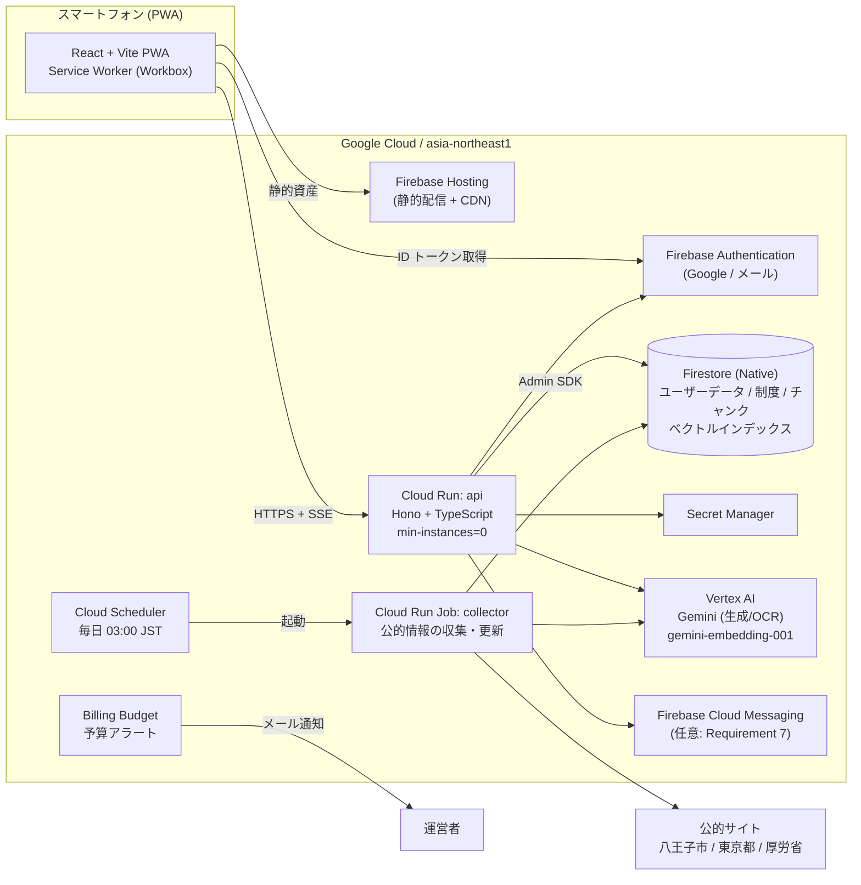
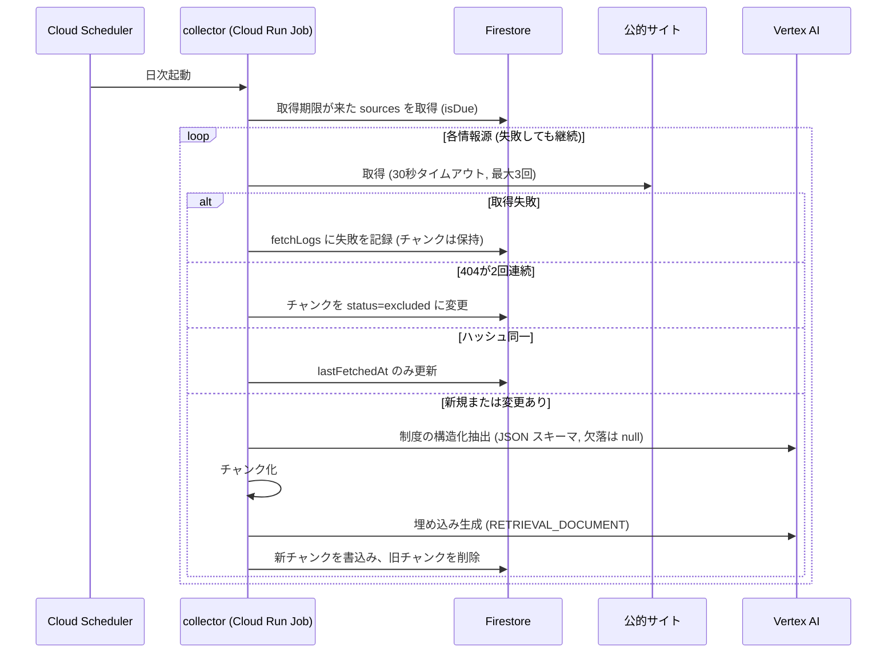
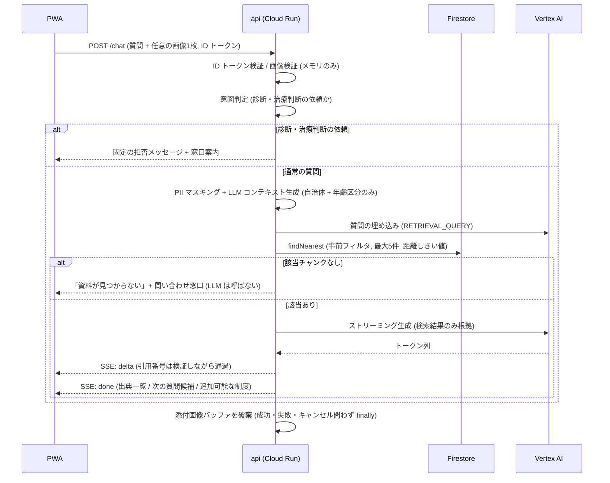
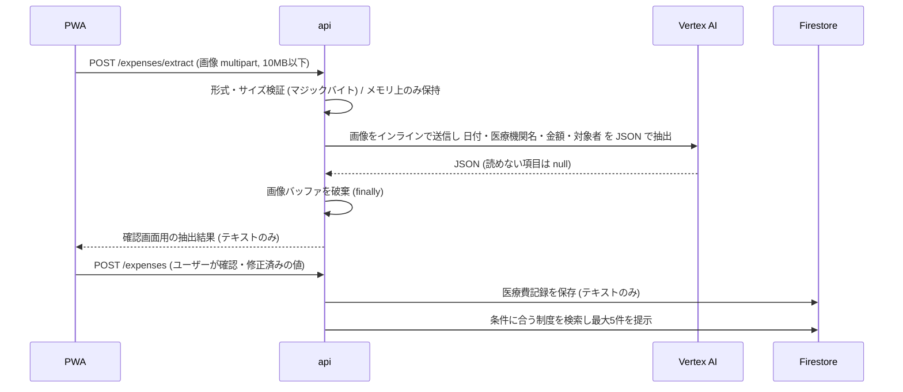
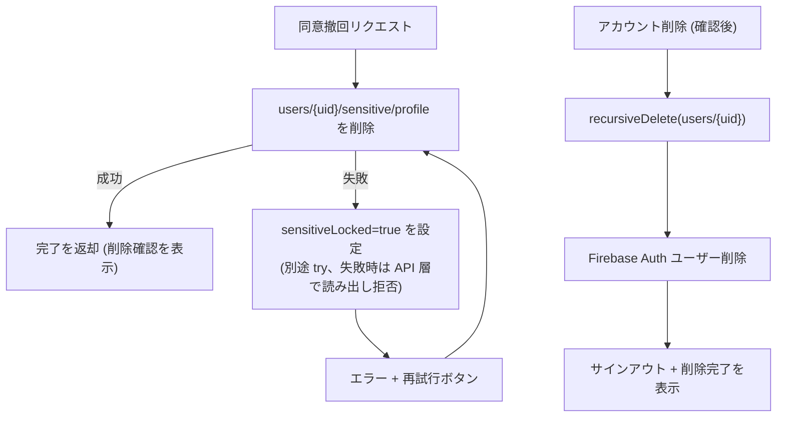

# 設計書: hachioji-gov（子育て世帯向け 医療・福祉情報ナビ）

## Overview

hachioji-gov は、八王子市の子育て世帯向けに、国・東京都・八王子市の公的情報を集約し、世帯に合う制度を提示し、出典つきでAIに相談できるスマートフォン向け PWA である。本設計書は `requirements.md`（Requirement 1〜13）を実現する技術設計を定義する。

### 設計の基本方針

| 方針 | 内容 | 関連要件 |
| --- | --- | --- |
| Google Cloud 一本化 | 東京リージョン（asia-northeast1）に統一する。AWS は使わない | Requirement 9.8, 13.6 |
| TypeScript 統一 | フロント・API・収集ジョブすべて TypeScript（Node.js 22） | 技術的制約 |
| サーバーレス | Cloud Run（min-instances=0）、Cloud Run Jobs、Firestore、Firebase Hosting のみ。常時稼働サーバーは使わない | Requirement 13.1 |
| ベクトルDBは Firestore | 別サービスを増やさず、メタデータ事前フィルタつき KNN を Firestore で行う | Requirement 3, 5 |
| 画像は保存しない | 領収書・チャット添付画像はメモリ上のみで処理し、Cloud Storage を使用しない | Requirement 5.10, 6.6, 9.5 |
| 設定の外出し | AIモデル名・リージョンは `config/app.config.json` に置き、コードに直書きしない | Requirement 13.6, 13.7 |

### 調査結果の要約（設計に反映した事項）

- Firestore のベクトル検索は KNN 検索で、ベクトルインデックスの種類は `flat`、次元は最大 2048、事前フィルタ（等価・配列条件）と複合インデックスを併用できる。埋め込みは Firestore では生成されないため、Vertex AI などで生成する必要がある。Standard エディションでは1クエリの返却上限は1000件。リアルタイムリスナーは非対応。Node.js クライアントは対応。出典: [Firestore ベクトル検索](https://firebase.google.com/docs/firestore/vector-search)
- Vertex AI の埋め込みモデル `gemini-embedding-001` は既定 3072 次元で、出力次元を指定して縮小できる（推奨は 3072 / 1536 / 768）。多言語・コード向けの旧モデル `text-embedding-005`、`text-multilingual-embedding-002` を統合した後継である。出典: [Get text embeddings（Google Cloud）](https://cloud.google.com/vertex-ai/generative-ai/docs/embeddings/get-text-embeddings)、[Gemini Embedding GA（Google Developers Blog）](https://developers.googleblog.com/zh-hans/gemini-embedding-available-gemini-api)
- 次元を縮小した埋め込みは正規化が必要になるため、保存前に L2 正規化を行い、距離は COSINE を用いる。
- Vertex AI 上のモデルの東京リージョン提供状況は変わりやすい。設計では「リージョンとモデル名を設定で切り替えられる」ことを前提にし、手順書で有効化と提供状況の確認を必須手順にしている。

> 注: 本書の料金・提供状況は設計時点の調査に基づく。実装前に最新の公式ドキュメントで再確認すること。

## Architecture

### システム構成図



### 構成要素の選定理由

| 要素 | 選定 | 理由 |
| --- | --- | --- |
| フロント | React + Vite + `vite-plugin-pwa`（Workbox） | PWA のオフラインキャッシュ（Requirement 12）を設定で実現できる。SSR が不要で Firebase Hosting の静的配信で足りる |
| API | Cloud Run + Hono | SSE ストリーミング（Requirement 12.1）に対応し、min-instances=0 で待機コストがゼロ（Requirement 13.1） |
| 認証 | Firebase Authentication（Google・メール／パスワード） | 管理が不要でクライアントSDKが豊富。メールのロックアウトのみ自前実装（後述） |
| DB | Firestore（Native、asia-northeast1） | サーバーレスで使用量課金、無料枠あり、ベクトル検索対応 |
| 収集 | Cloud Run Jobs + Cloud Scheduler | 日次バッチに最適。実行時間分のみ課金 |
| 生成AI | Vertex AI の Gemini（モデル名は設定） | 画像入力に対応し OCR と回答生成を同一サービスで賄える。Google Cloud 内で完結 |
| シークレット | Secret Manager | Requirement 9.10。Cloud Run からは Secret 参照で注入する |

### ベクトルDBの候補比較と推奨案

| 観点 | Firestore ベクトル検索（推奨） | Vertex AI RAG Engine | Vertex AI Vector Search |
| --- | --- | --- | --- |
| 追加インフラ | なし（既存 Firestore） | RAG コーパス管理が必要 | インデックスとエンドポイントの管理が必要 |
| 待機コスト | なし（使用量課金） | 利用するバックエンドDBの種類に依存 | デプロイ済みエンドポイントの常時課金が発生しやすく、20ドル予算に不向き |
| 東京リージョン | Firestore は asia-northeast1 で作成可 | リージョン・機能の提供状況に制約がある可能性があり、事前確認が必要 | 東京対応あり。ただし常時課金が課題 |
| メタデータフィルタ（自治体コード・年齢区分・カテゴリ） | 複合インデックスによる事前フィルタ（等価・配列包含）に対応 | 機能が限定的で、細かい条件制御がしにくい | フィルタ対応あり |
| 制御性（引用検証・出典URL保持） | チャンクにメタデータを自由に持てる | フレームワーク側で隠蔽される部分が多い | 良好 |
| 規模適合 | 数千〜数万チャンクで十分（`flat` 総当たり） | 過剰 | 数百万件向けで過剰 |
| ユーザーデータとの同居 | 同一DBで権限管理を一元化できる | 別管理 | 別管理 |

**推奨: Firestore ベクトル検索。** 想定コーパス（八王子市・東京都・厚労省の子育て関連で数千チャンク規模）では `flat` の総当たり検索で十分高速であり、待機コストがゼロで予算内に収まる。事前フィルタで自治体コード・年齢区分を絞るため検索対象はさらに小さくなる。将来、数十万チャンク規模（全国展開）になった場合は、`VectorStore` インターフェースの実装を Vertex AI Vector Search に差し替える（Components の `VectorStore` 参照）。

### データフロー

#### 1. 情報収集フロー（Requirement 3）



#### 2. AI 相談（RAG）フロー（Requirement 5, 10, 12）



#### 3. 領収書読み取りフロー（Requirement 6）



画像は Cloud Storage にも、Firestore にも、ディスクにも、ログにも書かない。リクエストボディはメモリ上の `Buffer` としてのみ扱い、処理完了時に `fill(0)` のうえ参照を破棄する。

#### 4. 同意撤回・アカウント削除フロー（Requirement 8, 9）



### データ配置とプライバシーの設計

| 方針 | 実装 | 関連要件 |
| --- | --- | --- |
| 要配慮情報の分離 | 障がい等の状況チップと、子どもの状況の自由記述は `users/{uid}/sensitive/profile` の1ドキュメントに隔離する。同意撤回はこのドキュメントの削除のみで完結する | Requirement 2.6, 2.7, 9.1〜9.4 |
| 画像の非永続化 | Cloud Storage を使用しない。`multipart` をメモリ上で処理し、`finally` で破棄する。Cloud Run のインメモリ FS 以外に書き込まない | Requirement 5.10, 6.6, 9.5 |
| ログのマスキング | 構造化ロガーを経由し、リクエストボディ・質問文・画像・メール・世帯情報を出力しない。出力は許可リストのフィールド（リクエストID、ステータス、所要時間、エラー種別）のみ | Requirement 9.5 |
| LLM への情報制限 | `buildLlmContext` が自治体名と年齢区分のみを生成する。質問文は `scrubPii` で電話番号・メールアドレス・郵便番号をマスクする | Requirement 9.9 |
| 所有者のみアクセス | API は ID トークンの `uid` と一致するパスのみ操作する。Firestore Security Rules でもクライアント直接アクセスを所有者に限定する | Requirement 9.6, 9.7 |
| Vertex AI の取り扱い | プロンプトの追加ログ出力（リクエスト・レスポンスのログ）を有効にしない。手順書で無効のままにすることを明記する | Requirement 9.5, 9.9 |

## Components and Interfaces

### リポジトリ構成（モノレポ）

```
hachioji-gov/
├── config/app.config.json        # AIモデル名・リージョンなど（コード外）
├── packages/
│   ├── shared/                   # 型・zod スキーマ・純粋関数（フロント/API/収集で共有）
│   ├── web/                      # React PWA
│   ├── api/                      # Cloud Run: Hono API
│   └── collector/                # Cloud Run Job: 収集
├── firebase/
│   ├── firestore.rules
│   └── firestore.indexes.json
└── docs/
    ├── hachiojigov.md
    └── google-cloud-setup.md     # ユーザー作業手順書
```

### 純粋ロジック（`packages/shared`）— プロパティベーステストの主対象

| 関数 | 役割 | 要件 |
| --- | --- | --- |
| `validateEmail` / `validatePassword` | メール（254文字以内、有効形式）とパスワード（8〜128文字）の検証 | 1.3, 1.4 |
| `evaluateLockout(attempts, now)` | 同一メール5連続失敗で15分ブロック | 1.8 |
| `classifyPostalCode(code, table)` | `hachioji` / `outside` / `notFound` / `invalidFormat` の分類 | 2.1〜2.3 |
| `validateChildren` / `validateFreeText` | 人数1〜20、年齢0〜18、自由記述200文字以内 | 2.4, 2.8 |
| `validateHouseholdInput` | 必須3項目のみで成立（任意項目は欠落可） | 2.5, 11.7, 11.8 |
| `splitByConsent(input, consent)` | 同意なしでは要配慮項目を保存ペイロードから除外 | 2.6, 2.7, 9.1, 9.2 |
| `ageToBand(age)` | 年齢を年齢区分タグに変換 | 3.4, 4.1, 5.1 |
| `isDue(source, now)` | 取得期限到来の判定 | 3.1 |
| `decideSourceAction(prevHash, newHash, missCount)` | skip / replace / exclude の決定 | 3.2, 3.3, 3.6 |
| `normalizeExtraction(raw)` | 欠落項目を null に正規化（推測しない） | 3.7 |
| `chunkProgram(program, meta)` | 制度をチャンクに分割しメタデータを付与 | 3.4 |
| `validateSourceRegistration` | 自治体コード・出典URLの検証 | 13.5 |
| `matchPrograms(household, programs)` | 自治体コード・年齢区分で制度を絞る | 4.1 |
| `toProgramCard(program)` | 要約60文字以内、`YYYY/MM/DD` の整形 | 4.2 |
| `upcomingDeadlines(applications, limit=5)` | 進行中申請を締切昇順で最大5件 | 4.5 |
| `filterByCategory` | カテゴリ絞り込み | 4.6 |
| `sanitizeCitations(text, n)` | 範囲外の引用番号の除去と出典一覧の生成 | 5.2, 5.3, 10.1 |
| `limitSuggestions(list, 3)` | 次の質問候補を最大3件に | 5.7 |
| `validateImage(meta, bytes, rule)` | MIME・マジックバイト・サイズ検証 | 5.5, 5.9, 6.1, 6.4 |
| `buildLlmContext(household)` / `scrubPii(text)` | LLM へ渡す属性の制限とPIIマスク | 9.9 |
| `validateExpense` / `canSaveExpense` | 金額1〜9,999,999の整数、全項目必須 | 6.2, 6.3 |
| `aggregateExpenses(records)` | 月別・年別・家族別の合計 | 6.2 |
| `notificationTimes(deadline)` / `cancelFor(queue, id)` | 7日前・1日前の通知計画と取消 | 7.1, 7.6 |
| `toProgramView(program)` | 出典・取得日・注意書きの表示モデル（欠落時は「未確認」） | 10.5, 10.6 |
| `LruCache<K,V>(50)` | Program 情報キャッシュの上限制御 | 12.3 |
| `streamReducer(state, event)` | ストリーミング受信の累積とエラー遷移 | 12.2, 12.6 |
| `loadConfig(raw)` | 設定の検証。欠落キー名を報告して失敗 | 13.6, 13.7 |
| `l2Normalize(vec)` | 埋め込みの L2 正規化 | 3.3, 5.1 |
| `encodeProgram` / `decodeProgram`（Chunk, Expense も同様） | Firestore ドキュメントとドメイン型の変換 | 3.3 |

### 外部境界のインターフェース（差し替え可能）

```ts
// ベクトルストア。Firestore 実装と、テスト用インメモリ実装を持つ。
export interface VectorStore {
  upsertChunks(sourceId: string, chunks: Chunk[]): Promise<void>;       // 新チャンクを書き込み、旧チャンクを削除
  search(q: {
    embedding: number[];
    municipalityCodes: string[];    // 例: ["13201","13000","00000"]（市・都・国）
    ageBands: AgeBand[];            // 子どもの年齢区分
    category?: Category;
    programId?: string;             // 「AIに聞く」で制度に限定する場合
    limit: number;                  // 最大5
    maxDistance: number;            // 距離しきい値（設定）
  }): Promise<RetrievedChunk[]>;    // 距離の昇順
  markExcluded(sourceId: string): Promise<void>;
}

export interface Embedder {
  embed(texts: string[], task: "RETRIEVAL_DOCUMENT" | "RETRIEVAL_QUERY"): Promise<number[][]>; // L2正規化済み
}

export interface Llm {
  streamAnswer(input: { system: string; context: RetrievedChunk[]; question: string; image?: Uint8Array }): AsyncIterable<string>;
  extractReceipt(image: Uint8Array): Promise<RawReceipt>;     // 読めない項目は null
  extractProgram(text: string): Promise<RawProgram>;          // 欠落は null
  classifyIntent(question: string): Promise<"general" | "medical_judgment">;
}

export interface Fetcher { fetch(url: string, opts: { timeoutMs: number }): Promise<FetchResult>; }
```

### API エンドポイント（Cloud Run: api）

| メソッド・パス | 概要 | 要件 |
| --- | --- | --- |
| `POST /auth/login` | メール／パスワードログイン。サーバー側でロックアウトを判定し、Identity Toolkit REST の検証後にカスタムトークンを返す | 1.6〜1.8 |
| `POST /auth/register` | メール登録（検証後）。規約・プライバシーポリシー同意の記録 | 1.3, 1.4, 9.11 |
| `GET/PUT /household` | 世帯情報の取得・更新 | 2, 8.1, 8.2 |
| `POST /consents/sensitive` / `DELETE /consents/sensitive` | 要配慮情報の同意・撤回（撤回で即時削除） | 2.6, 9.1〜9.4 |
| `GET /postal/:code` | 郵便番号の解決 | 2.1〜2.3 |
| `GET /dashboard` | 制度・進行中の申請・締切（セクションごとに結果とエラーを返す） | 4 |
| `GET /programs/:id` | 制度詳細（`Cache-Control` と `X-Cached-At` を付与） | 4.3, 12.3 |
| `PUT /applications/:programId` | 申請状況（未着手・進行中・完了）の更新 | 4.5, 7.6 |
| `POST /chat`（SSE） | 質問（任意の画像1枚）。SSE イベント: `delta` / `sources` / `suggestions` / `proposal` / `done` / `error` | 5, 10, 12 |
| `POST /expenses/extract` | 領収書画像からテキスト抽出（画像は保存しない） | 6.1, 6.4, 6.6 |
| `POST /expenses` / `GET /expenses/summary` | 医療費記録の保存・集計・制度提示 | 6.2, 6.5 |
| `DELETE /account` | アカウントと全データの削除（確認はクライアント側ダイアログ後に呼ぶ） | 8.3〜8.5 |
| `POST /devices` | 通知トークン登録（優先度：できれば） | 7 |

共通ミドルウェア: ID トークン検証（`uid` 取得）→ 認可（パスの `uid` と一致）→ 構造化ログ（マスキング）→ エラーハンドラ。未認証・他人のデータは `401/403` を返し、データを変更しない（Requirement 9.7）。

### ログイン処理とロックアウト（Requirement 1.7, 1.8）

Firebase Authentication の組み込み制限は5回15分の仕様と一致しないため、メール／パスワードのログインは API 経由にする。`POST /auth/login` はメールの SHA-256 ハッシュをキーに `loginAttempts/{hash}` へ失敗回数と最終失敗時刻を保存し、`evaluateLockout` が5連続失敗で15分ブロックを返す。失敗時の文言は常に同一にし、メールが登録済みかどうかを明かさない。Google ログインはクライアントSDKで直接行う。

### 画面構成とPWA（Requirement 11, 12）

- 下部タブバー4項目（ホーム／さがす／AI相談／マイホーム）を常設。現在のタブはラベルの太さとアイコンの塗りの変化で示し、色だけに頼らない。
- 基準幅 390px、対応幅 360〜430px。タップ領域は 44px 以上、隣接間隔 8px 以上。
- `manifest.webmanifest` で `display: "standalone"`。インストール案内は `beforeinstallprompt`（iOS は「ホーム画面に追加」の案内）。
- Service Worker（Workbox）: 静的資産は Precache。`GET /programs/:id` は NetworkFirst（`networkTimeoutSeconds: 5`）と `ExpirationPlugin({ maxEntries: 50 })` を適用し、フォールバック時は「最新でない可能性」と最後のキャッシュ時刻を表示する。チャットの `POST` と画像は一切キャッシュしない。
- チャット画面最上部に、閉じられない注意書き「診断や治療の判断は医師が行います」を固定表示する（Requirement 10.4）。

## Data Models

### Firestore コレクション設計

```
users/{uid}                          # ユーザー（本人のみ）
  household        (map)   postalCode, municipalityCode, prefecture, city, town,
                           parent{name?, age?, gender?}（任意）, createdAt, updatedAt
  children         (array) [{ id, age, gender? }]
  consents         (map)   termsAcceptedAt, privacyAcceptedAt, sensitiveConsent{grantedAt|null}, sensitiveLocked
  sensitive/profile        # 要配慮情報だけを隔離（同意撤回で削除）
      childStatus: [{ childId, chips: string[], freeText?: string }]
  applications/{programId}         status, deadline, tasks[{id,title,done}], updatedAt
  expenses/{expenseId}             date, clinicName, amountYen(int), memberId, createdAt   # 画像は含めない
  chats/{chatId}/messages/{id}     role, text, citations[{n, chunkId, title, url}], createdAt  # 画像は含めない
  devices/{token}                  platform, createdAt                                      # 優先度：できれば
  notifications/{id}               programId, kind(7d|1d), sendAt, attempts, status

loginAttempts/{emailHash}            failCount, lastFailAt, blockedUntil   # サーバーのみ

sources/{sourceId}                   url, municipalityCode, level, kind(html|pdf), intervalHours(24),
                                     lastHash, lastFetchedAt, missCount, status(active|excluded), enabled
fetchLogs/{id}                       sourceId, url, at, ok, errorKind, message(個人情報なし)
programs/{programId}                 name, target, content, howToApply, requiredDocs[], deadline,
                                     contact, level, municipalityCode, ageBands[], category,
                                     sourceUrl, fetchedAt, sourceId
chunks/{chunkId}                     下記参照
```

### チャンク設計

| 項目 | 設計 |
| --- | --- |
| 分割単位 | 1制度を意味単位（概要／対象／内容／申請方法／必要書類・締切／問い合わせ先）に分割。各チャンク先頭に `【制度名】【自治体・レベル】【項目名】` を付け、単独で意味が通じるようにする |
| 長さ | 目標 300〜800文字。上限を超える長い項目と、構造化できなかった PDF 本文は 800文字（句点「。」で区切り）、重なり 100文字で分割 |
| ID | `sha256(sourceId + sectionKey + index)` の先頭32文字。再実行で同じIDになり冪等 |
| 置換 | 変更検知時、新しい `contentVersion` で書き込んだ後に旧バージョンのチャンクを削除（取得失敗時は何も触らない） |

### `chunks` ドキュメントのスキーマ

| フィールド | 型 | 説明 |
| --- | --- | --- |
| `text` | string | 本文（先頭にヘッダ付き） |
| `embedding` | vector(768) | `gemini-embedding-001`（`outputDimensionality=768`）、L2 正規化済み |
| `programId` | string | 所属する制度ID |
| `sourceId` | string | 情報源ID |
| `sourceUrl` | string | 出典URL（必須） |
| `sourceTitle` | string | 資料名 |
| `fetchedAt` | timestamp | 取得日（必須） |
| `municipalityCode` | string | 例: 八王子市 `13201`、東京都 `13000`、国 `00000` |
| `level` | string | `national` / `tokyo` / `municipal` |
| `ageBands` | string[] | 対象年齢区分。下表。制限なしは全区分を列挙する |
| `category` | string | `childcare` / `medical` / `pregnancy` / `education` / `welfare` ほか |
| `status` | string | `active` / `excluded` |
| `contentHash` | string | 元コンテンツのハッシュ |
| `contentVersion` | string | 置換制御用 |

#### 年齢区分タグ

| タグ | 対象 |
| --- | --- |
| `pregnancy` | 妊娠・出産（妊婦、出産前後） |
| `age_0_2` | 0〜2歳 |
| `age_3_5` | 3〜5歳 |
| `age_6_11` | 6〜11歳 |
| `age_12_14` | 12〜14歳 |
| `age_15_18` | 15〜18歳 |

### 埋め込みモデルとインデックス

| 項目 | 値 | 理由 |
| --- | --- | --- |
| 埋め込みモデル | `gemini-embedding-001`（設定 `embeddingModel`） | 日本語を含む多言語に対応する Google の最新の汎用モデル。旧 `text-multilingual-embedding-002` の後継 |
| 次元 | 768（設定 `embeddingDimensions`） | 3072 から縮小。Firestore の上限 2048 以内で、保存・検索コストが小さい。推奨次元の一つ |
| 正規化 | 保存前・クエリ前に L2 正規化 | 縮小次元では正規化が必要 |
| タスク種別 | 文書は `RETRIEVAL_DOCUMENT`、質問は `RETRIEVAL_QUERY` | 検索精度の向上 |
| 距離指標 | `COSINE`（`distanceResultField` を取得） | しきい値は設定 `maxDistance`（初期値は評価セットで調整） |
| インデックス種別 | `flat` | Firestore が対応する種別 |

#### 複合ベクトルインデックス（2本）

```
# ① 通常の RAG 検索（自治体 + 状態 + 年齢区分で事前フィルタ）
gcloud firestore indexes composite create \
  --database=(default) --collection-group=chunks --query-scope=COLLECTION \
  --field-config=order=ASCENDING,field-path=municipalityCode \
  --field-config=order=ASCENDING,field-path=status \
  --field-config=array-config=CONTAINS,field-path=ageBands \
  --field-config=field-path=embedding,vector-config='{"dimension":"768","flat":"{}"}'

# ② 制度に限定した検索（「AIに聞く」）
gcloud firestore indexes composite create \
  --database=(default) --collection-group=chunks --query-scope=COLLECTION \
  --field-config=order=ASCENDING,field-path=programId \
  --field-config=order=ASCENDING,field-path=status \
  --field-config=field-path=embedding,vector-config='{"dimension":"768","flat":"{}"}'
```

検索は `municipalityCode` ごと（市・都・国の3つ）に `findNearest` を並列実行し、`ageBands` の `array-contains-any` で年齢を絞り、結果を距離順に統合して上位5件を返す。カテゴリは取得結果の後段で絞る（カテゴリ付きで高精度化が必要になった場合に `category` を含む3本目のインデックスを追加する）。`in` と配列条件の組合せ制約を避けるため、自治体コードは複数クエリに分けている。実際に必要なインデックスは、不足時に Firestore が返すエラーのリンクからも確認できる。

### 設定ファイル（`config/app.config.json`）

```json
{
  "gcp": { "projectId": "<PROJECT_ID>", "region": "asia-northeast1", "vertexLocation": "asia-northeast1" },
  "ai": {
    "generationModel": "gemini-2.5-flash",
    "intentModel": "gemini-2.5-flash-lite",
    "embeddingModel": "gemini-embedding-001",
    "embeddingDimensions": 768
  },
  "rag": { "topK": 5, "maxDistance": 0.45 },
  "collector": { "defaultIntervalHours": 24, "timeoutMs": 30000, "maxRetries": 3 }
}
```

起動時に zod で検証し、必須キー（`gcp.region`、`ai.generationModel` ほか）が欠落または空なら、キー名を出力して起動に失敗する。値は設計時点の例であり、実装時に提供状況を確認して決める。

### Firestore Security Rules（方針）

- `users/{uid}/**`: `request.auth.uid == uid` の場合のみ読み書き可。ただし `sensitive` と `consents.sensitiveLocked` の書き込みは API 経由に限定する。
- `programs/*`: 認証済みユーザーは読み取りのみ。書き込み不可。
- `chunks`、`sources`、`fetchLogs`、`loginAttempts`: クライアントからは全拒否（Admin SDK のみ）。

### ユーザー作業ドキュメント（`docs/google-cloud-setup.md`）

Google Cloud 側の設定は、開発者本人が手作業で行う必要がある。AI や CI では代行できない（課金アカウントの紐付け、認証、同意操作を含むため）。手順は別ドキュメント `docs/google-cloud-setup.md` にまとめる。範囲は以下のとおり。

| 区分 | 内容 | 関連要件 |
| --- | --- | --- |
| プロジェクト | プロジェクト作成、課金アカウント紐付け | 13.1 |
| 予算 | 20ドルの予算と 50% / 80% / 100% のアラート、通知先メール | 13.2, 13.3 |
| API 有効化 | Firestore、Cloud Run、Cloud Build、Artifact Registry、Cloud Scheduler、Secret Manager、Vertex AI、Identity Toolkit、FCM など | 全般 |
| Firebase / Authentication | Firebase の追加、Google プロバイダーとメール／パスワードの有効化、承認済みドメイン | 1 |
| Firestore | 東京リージョンで Native モードのDB作成、Rules とインデックス（ベクトルを含む）のデプロイ | 9.8, 3, 5 |
| Secret Manager | シークレット登録の方法（値は書かない）、Cloud Run への参照設定 | 9.10 |
| サービスアカウント / IAM | api 用、collector 用、Scheduler 起動用の最小権限 | 9.6 |
| Cloud Run / Scheduler | デプロイ、min-instances=0、Job の作成、日次スケジュール | 13.1, 3.1 |
| Vertex AI | Gemini・埋め込みモデルの利用可否の確認（東京リージョン）、プロンプトログを有効化しない | 9.5, 9.9 |
| Hosting | Firebase Hosting へのデプロイ | 11.2 |
| 設定の控え | `app.config.json` に入れる値の一覧（シークレットを除く） | 13.6 |

## Correctness Properties

*A property is a characteristic or behavior that should hold true across all valid executions of a system-essentially, a formal statement about what the system should do. Properties serve as the bridge between human-readable specifications and machine-verifiable correctness guarantees.*

プロパティ反映（冗長性の整理）: 年齢・人数の検証（2.8）と自由記述（2.4）は「入力検証」として別プロパティのままにした。同意関連の 2.6/2.7/9.1/9.2 は1つに統合した。画像検証（5.5/5.9/6.1/6.4）は1つに統合し、画像の非永続化（5.10/6.6/9.5）は別プロパティにした。引用検証（5.2/5.3/10.1）は1つに統合した。

### Property 1: メール・パスワード検証の正確性

*For any* メールアドレス文字列とパスワード文字列について、`validateEmail` が受理するのは「254文字以内かつ有効な形式」の場合に限り、`validatePassword` が受理するのは「8〜128文字」の場合に限る。

**Validates: Requirements 1.3, 1.4**

### Property 2: ログイン失敗のロックアウト

*For any* 失敗・成功の列と時刻の列について、`evaluateLockout` は同一メールで連続5回失敗した時点から15分間だけブロックを返し、成功が挟まれば失敗カウントがリセットされ、リファレンスモデルと一致する。

**Validates: Requirements 1.8**

### Property 3: 郵便番号の分類

*For any* 文字列について、`classifyPostalCode` は7桁数字でなければ `invalidFormat` を、7桁で郵便番号テーブルに存在しなければ `notFound`（進行不可）を、八王子市外であれば `outside`（国の制度のみで続行する選択肢を伴う）を、八王子市内であれば `hachioji`（都道府県・市区町村・町名と情報源を伴う）を返す。

**Validates: Requirements 2.1, 2.2, 2.3**

### Property 4: 子ども情報と自由記述の検証

*For any* 整数の人数と年齢、および任意の長さの自由記述について、人数が1〜20、年齢が0〜18、自由記述が200文字以内である場合に限り受理される。

**Validates: Requirements 2.4, 2.8**

### Property 5: 任意項目の欠落を許容する

*For any* 世帯入力について、必須3項目（郵便番号、子どもの人数、子どもの年齢）が有効であれば、任意項目をどの組合せで欠落させても `validateHouseholdInput` は受理する。

**Validates: Requirements 2.5, 11.7, 11.8**

### Property 6: 同意なしでは要配慮情報を保存しない

*For any* 世帯入力と同意状態について、`splitByConsent` の結果は、同意が付与されていない場合に要配慮情報（障がい等の状況チップと関連する自由記述）を保存ペイロードに一切含まず、非要配慮項目は保持する。

**Validates: Requirements 2.6, 2.7, 9.1, 9.2**

### Property 7: 同意撤回で要配慮情報のみが消える

*For any* ユーザーデータについて、同意撤回の後は要配慮情報が存在せず、要配慮でないデータ（世帯情報、申請、医療費記録）は変化しない。削除に失敗した場合は `sensitiveLocked` により、削除処理以外の読み出しが拒否される。

**Validates: Requirements 9.3, 9.4**

### Property 8: 取得期限の判定

*For any* 最終取得時刻、現在時刻、取得間隔について、`isDue` は経過時間が間隔以上である場合に限り真を返す。また、有効に登録された任意の情報源は、コード変更なしで次回の `listDueSources` に含まれる。

**Validates: Requirements 3.1, 13.4**

### Property 9: 同一内容は再処理されない（冪等）

*For any* 情報源の内容について、同じ内容を2回続けて処理しても、2回目はチャンクの書き込みが発生せず、既存チャンクは変化せず、最終取得日時のみが更新される。

**Validates: Requirements 3.2**

### Property 10: 変更時は旧チャンクが完全に置換される

*For any* 情報源の旧内容と、ハッシュの異なる新内容について、処理後にその情報源に属するチャンクは新内容由来のものだけで構成され、旧チャンクは残らない。

**Validates: Requirements 3.3**

### Property 11: すべてのチャンクが必須メタデータを持つ

*For any* 制度から `chunkProgram` が生成したすべてのチャンクについて、出典URL、取得日、`municipalityCode`、`level`、`ageBands`、`category` が欠けずに付与されている。

**Validates: Requirements 3.4**

### Property 12: 取得失敗はデータを壊さず、他の情報源を止めない

*For any* 情報源の集合と、失敗する情報源の任意の部分集合について、失敗した情報源の既存チャンクは変化せず、エラー記録が残り、失敗しなかった残りの情報源はすべて処理される。

**Validates: Requirements 3.5, 3.8**

### Property 13: 2回連続の「見つからない」で除外される

*For any* 取得結果（成功・404）の列について、`decideSourceAction` は末尾が2回連続の404である場合に限り、その情報源のチャンクを除外対象にする。

**Validates: Requirements 3.6**

### Property 14: 欠落項目は推測せず null で保存される

*For any* キーの部分集合のみを持つ抽出結果について、`normalizeExtraction` は欠落したキーを `null` にし、存在するキーの値は変更しない。

**Validates: Requirements 3.7**

### Property 15: 制度の絞り込み（健全性と完全性）

*For any* 世帯情報と制度の集合について、`matchPrograms` が返す制度は、自治体コード（市・都・国）と年齢区分が世帯に一致するものだけであり、一致する制度は漏れなくすべて含まれる。

**Validates: Requirements 4.1**

### Property 16: 制度カードの表示制約

*For any* 制度について、`toProgramCard` の要約は60文字以内で、更新日は `YYYY/MM/DD` 形式であり、行政レベル・対象の家族・出典名が含まれる。

**Validates: Requirements 4.2**

### Property 17: 検索条件の制度限定

*For any* `programId` について、「AIに聞く」から生成される検索条件は、そのProgram のチャンクのみを対象とする。

**Validates: Requirements 4.4**

### Property 18: 締切表示は近い順で最大5件

*For any* 申請の集合について、`upcomingDeadlines` は「進行中」の申請のみを、締切の昇順で、最大5件返す。

**Validates: Requirements 4.5**

### Property 19: カテゴリ絞り込みは制度のみに作用する

*For any* 制度の集合とカテゴリについて、絞り込み後の制度はすべて選択カテゴリに一致し、一致するものは漏れず、進行中の申請と締切の結果は変化しない。

**Validates: Requirements 4.6**

### Property 20: 検索結果は条件を満たし、最大5件で距離順

*For any* チャンクの集合、世帯情報、クエリ埋め込みについて、`VectorStore.search` の結果は、すべて自治体コード・年齢区分・`status=active` の条件を満たし、5件以下で、距離の昇順に並ぶ。

**Validates: Requirements 5.1**

### Property 21: 引用の整合

*For any* 回答テキストと検索結果の件数 N について、`sanitizeCitations` の出力に含まれる引用番号はすべて 1〜N の範囲内で、表示される出典一覧は残った引用番号と一対一に対応する。引用が1件もない事実回答には「出典未確認」の注意が付く。

**Validates: Requirements 5.2, 5.3, 10.1**

### Property 22: 根拠がなければ生成しない

*For any* 質問について、検索結果が空、またはすべて距離しきい値を超える場合、LLM の生成は呼び出されず、「資料が見つからない」旨と八王子市の問い合わせ窓口の案内を返す。

**Validates: Requirements 5.4, 10.2**

### Property 23: 画像検証

*For any* ファイル（MIME、マジックバイト、サイズ）について、`validateImage` はJPEG／PNG（チャット添付は一般的な画像形式）で、実体が宣言と一致し、サイズが10 MB以下である場合に限り受理する。

**Validates: Requirements 5.5, 5.9, 6.1, 6.4**

### Property 24: 次の質問候補は最大3件

*For any* 候補リストについて、`limitSuggestions` の出力は3件以下で、入力の先頭からの部分列である。

**Validates: Requirements 5.7**

### Property 25: 画像は処理結果にかかわらず保存されず破棄される

*For any* 画像と処理結果（成功・失敗・キャンセル）について、処理の終了後に画像バッファは破棄され、永続ストレージ・Firestore・ロガーへの書き込みは1件も発生しない。

**Validates: Requirements 5.10, 6.6, 9.5**

### Property 26: 医療費記録の検証と保存可否

*For any* 医療費記録の入力について、金額が1〜9,999,999の整数であり、日付・医療機関名・金額・対象者がすべて入力されている場合に限り `canSaveExpense` は真を返す。

**Validates: Requirements 6.2, 6.3**

### Property 27: 医療費集計の整合

*For any* 医療費記録の集合について、暦月別・暦年別・家族別の合計は、該当する記録の金額の合計と一致し、月別合計の和は年別合計に、家族別合計の和は全体合計に等しい。

**Validates: Requirements 6.2**

### Property 28: 提示する制度は最大5件で出典つき

*For any* 集計結果と制度の集合について、提示される制度は5件以下で、各件に出典URLと取得日が付き、不足している必要書類が示される。

**Validates: Requirements 6.5**

### Property 29: 通知の計画と取消

*For any* 締切について、`notificationTimes` は締切の7日前と1日前の2つのみを返し、*for any* 通知キューと完了・削除された申請について、`cancelFor` の後にキューにその申請の通知は残らず、他の申請の通知は変化しない。

**Validates: Requirements 7.1, 7.6**

### Property 30: アカウント削除の完全性と分離

*For any* 複数ユーザーのデータについて、あるユーザーの削除後、そのユーザー配下のデータは存在せず、他のユーザーのデータは変化しない。

**Validates: Requirements 8.3**

### Property 31: 所有者以外のアクセスは拒否される

*For any* リクエストとリソースの所有者について、認証済みの所有者本人以外、または未認証のリクエストは拒否され、データは変更されない。

**Validates: Requirements 9.6, 9.7**

### Property 32: LLM に渡す情報の制限

*For any* 世帯情報（氏名、住所、連絡先、要配慮情報を含む）と質問文について、`buildLlmContext` と `scrubPii` を通したプロンプト全体には、氏名、住所、連絡先、要配慮情報が含まれず、ユーザー由来の属性は自治体と年齢区分のみである。

**Validates: Requirements 9.9**

### Property 33: 出典の表示モデル

*For any* 制度について、`toProgramView` は常に「最新情報は窓口で確認」の注意書きを含み、出典URLまたは取得日が欠けている場合は「出典未確認」の表示を含む。取得日は `YYYY-MM-DD` 形式で表示される。

**Validates: Requirements 10.5, 10.6**

### Property 34: ストリーミング累積の正確性

*For any* デルタ（テキスト断片）の列について、`streamReducer` が表示する本文は、受信順に連結した文字列と一致する。途中でエラーになっても、それまでの本文は保持される。

**Validates: Requirements 12.2**

### Property 35: キャッシュは最大50件で最終利用が最古のものを削除する

*For any* アクセス列について、`LruCache(50)` の件数は50以下で、上限超過時には最も長く開かれていない項目が削除され、リファレンスモデルと一致する。

**Validates: Requirements 12.3**

### Property 36: 情報源の登録検証

*For any* 情報源の登録入力について、有効な自治体コードと出典URLの両方が揃っている場合に限り登録され、そうでなければ拒否されて既存の登録は変化せず、欠落または無効な項目名が報告される。

**Validates: Requirements 13.5**

### Property 37: 設定の検証

*For any* 設定オブジェクトについて、必須キー（AIモデル名、リージョン）が欠落または空である場合に限り `loadConfig` は失敗し、エラーには欠けているキー名が含まれる。

**Validates: Requirements 13.6, 13.7**

### Property 38: シリアライズのラウンドトリップ

*For any* 有効な Program、Chunk、ExpenseRecord について、`decode(encode(x))` は元の値と等価である。

**Validates: Requirements 3.3, 6.2**

### Property 39: 埋め込みの正規化

*For any* 非零ベクトルについて、`l2Normalize` の出力のノルムは 1（許容誤差内）であり、方向は変わらない。

**Validates: Requirements 3.3, 5.1**

## Error Handling

| 事象 | 対応 | 要件 |
| --- | --- | --- |
| 未認証アクセス | 401 を返し、クライアントは登録・ログイン画面へ。保護画面は描画しない | 1.1, 9.7 |
| Google 認証キャンセル／失敗／10秒超 | ログイン画面にとどまり、エラーと再試行を表示 | 1.5 |
| 認証情報不一致 | 登録有無を明かさない同一文言。5連続失敗で15分ブロックし残り時間を表示 | 1.7, 1.8 |
| 入力検証エラー | 該当入力欄の隣にメッセージを表示し、他の入力値を保持 | 1.4, 2.3, 2.8 |
| 収集の取得失敗 | 3回再試行後、既存チャンクを保持して `fetchLogs` に記録。他の情報源は継続 | 3.5, 3.8 |
| 抽出で項目欠落 | 推測せず null で保存 | 3.7 |
| ダッシュボードのセクション失敗 | セクション単位で `Promise.allSettled`。失敗セクションだけにエラーと再試行を表示 | 4.8 |
| 検索結果ゼロ／距離しきい値超過 | LLM を呼ばず、固定メッセージと窓口案内 | 5.4, 10.2 |
| 添付画像が不正 | 画像を即破棄し、質問文を保持したままエラーを表示 | 5.9 |
| 領収書の抽出失敗／30秒超 | 画像を即破棄、再アップロードか手入力を提示。読めない項目は空欄で強調 | 6.3, 6.4 |
| 画像の破棄の失敗 | バッファはメモリのみのため、プロセス終了で消滅。参照を即時に切り、再試行ループと時刻・原因のログ記録を行い（画像は記録しない）、他機能からはアクセス不能 | 6.7 |
| 同意撤回時の削除失敗 | エラー表示、`sensitiveLocked` でアクセス遮断、再試行を提示 | 9.4 |
| アカウント削除の一部失敗 | エラー表示、サインイン状態を維持、再試行を可能にする | 8.5 |
| ストリーム中断 | 受信済みの本文を保持し、エラー表示と再送信ボタンを提示 | 12.6 |
| オフライン／5秒超 | キャッシュ済み制度を「最新でない可能性」と最終キャッシュ時刻つきで表示。未キャッシュは利用不可を表示 | 12.4, 12.5 |
| プッシュ通知失敗 | 5分間隔で最大3回再試行し、失敗時はアプリ内お知らせにする | 7.5 |
| 設定の欠落 | 起動時に欠落キー名を出力して失敗 | 13.7 |
| 予算超過 | 予算アラートのメールで運営者に通知（24時間以内） | 13.3 |

ログに出力してよい項目は許可リスト方式とし、例外オブジェクトのメッセージにリクエスト内容が含まれる場合は出力前に除去する。

## Testing Strategy

### 方針

ユニットテストとプロパティベーステストを併用する。ユニットテストは具体例・境界・エラー経路を、プロパティベーステストは任意入力に対する普遍的性質を検証する。

- テストランナー: Vitest
- プロパティベーステスト: fast-check（自前実装はしない）。各プロパティは単一のプロパティテストで実装し、`numRuns` は100以上とする。
- タグ形式: 各テストにコメントで `Feature: childcare-medical-welfare-navi, Property {番号}: {プロパティ名}` を付ける。
- 対象は `packages/shared` の純粋関数と、`VectorStore` / `Embedder` / `Llm` / `Fetcher` のインメモリ実装を差し込んだサービス層。

### テストの種別

| 種別 | 対象 | ツール |
| --- | --- | --- |
| プロパティテスト | Correctness Properties の 1〜39 | Vitest + fast-check |
| ユニットテスト | 具体例・エラー経路（認証エラー文言、空状態、画像破棄の失敗注入、診断依頼の拒否など） | Vitest |
| 統合テスト | Firestore エミュレータでの Security Rules、ベクトル検索の実クエリ（1〜3例）、ログイン処理 | Firebase Emulator Suite |
| コンポーネント／スナップショット | 詳細画面、タブバー、空状態、注意書き | Vitest + Testing Library |
| E2E／アクセシビリティ | 360〜430px の横スクロール、タップ領域、コントラスト、オフライン動作、PWA インストール | Playwright + axe-core、Lighthouse |
| RAG 評価セット | 質問と期待する出典の約20問による回答品質の確認、診断依頼の拒否 | 手動実行スクリプト（Requirement 5.8, 10.3 の確認） |
| スモーク／インフラ確認 | 東京リージョン、min-instances=0、予算アラート、シークレットがコードに含まれないこと | `gcloud` の確認コマンド（手順書）、シークレットスキャン |

### PBT を適用しない領域と代替

- UI のレンダリング・レイアウト・アクセシビリティ（Requirement 11）: スナップショット、axe、Lighthouse、E2E で検証する。
- 外部サービスの動作（Firebase Auth、FCM、Vertex AI の応答品質、Cloud Scheduler）: 統合テストとモックによる例示テスト。
- 性能目標（3秒、5秒、15秒）: 統合テストと手動計測。
- LLM の意図分類と回答品質: 評価セットで確認する。決定論的な部分（拒否文言の返却、LLM を呼ばない分岐、引用の検証）のみプロパティで検証する。

### 画像非永続化の検証

Property 25 は、`StorageSink`（ファイル／Cloud Storage／Firestore／ロガー）をスパイに置き換えた状態で、処理結果をランダムに変えて実行し、書き込み呼び出しが0件であること、`finally` でバッファが破棄されることを確認する。加えて、ソースコード検査（`@google-cloud/storage` の依存が存在しないこと、`fs.write*` が画像処理経路から呼ばれないこと）を CI で行う。
